# AgentControl

## Architecture

AgentControl is an Avalonia desktop application built on .NET 10. Per architecture.md's
Purpose, it lets a developer open a repo from a recent-repos list, have the tool ensure the
repo's proprietary agent-configuration folders match a pinned package version, optionally
pull the latest commits, and then launch a preferred agentic CLI tool in that repo's working
directory. It is structured as one system containing one top-level unit (`Program`) and eleven
subsystems, matching architecture.md's Software Structure diagram:

```mermaid
flowchart TD
    Program
    subgraph LauncherUI
        MainWindowViewModel
        RepoCardViewModel
        SelectPackageWindowViewModel
        SettingsWindowViewModel
        SourceEditorViewModel
        CredentialPromptViewModel
        RepoImageLocator
        RepoGroupHeaderViewModel
        GroupNameViewModel
        DialogBehavior
    end
    subgraph AgentPackageManagement
        PackageSource
        PackageVersion
        PackageVersionCache
        PackageSourceRegistry
        ZipFolderSourceProvider
        NuGetSourceProvider
        SignatureVerificationSupport
    end
    subgraph PackageCredentials
        FeedOrigin
        SessionCredentialStore
        PackageCredentialCallback
        SecretRedactingLogger
    end
    subgraph RepoSync
        PackageContentExtractor
        PackageZipExtractor
        ReleaseNotesViewerViewModel
    end
    subgraph RepoConfig
        RepoPinStore
    end
    subgraph AgentToolLauncher
        ShellDetector
        AgentToolLauncher_Unit[AgentToolLauncher]
    end
    subgraph GitIntegration
        GitClient
        GitCredentialClient
        CommittedAgentFilesCache
    end
    subgraph Settings
        SettingsStore
    end
    subgraph Logging
        LoggingSetup
    end
    subgraph Startup
        StartupOptions
    end
    subgraph Utilities
        PathHelpers
    end
    Program --> StartupOptions
    Program --> LoggingSetup
    Program --> MainWindowViewModel
    MainWindowViewModel --> RepoCardViewModel
    MainWindowViewModel --> SettingsStore
    RepoCardViewModel --> PackageSourceRegistry
    RepoCardViewModel --> PackageVersionCache
    PackageSourceRegistry --> ZipFolderSourceProvider
    PackageSourceRegistry --> NuGetSourceProvider
    ZipFolderSourceProvider --> PackageSource
    NuGetSourceProvider --> PackageCredentialCallback
    NuGetSourceProvider --> SecretRedactingLogger
    NuGetSourceProvider --> SignatureVerificationSupport
    SourceEditorViewModel --> SignatureVerificationSupport
    PackageCredentialCallback --> SessionCredentialStore
    PackageCredentialCallback --> FeedOrigin
    SettingsWindowViewModel --> SourceEditorViewModel
    PackageCredentialCallback -.->|ICredentialPrompt| CredentialPromptViewModel
    PackageCredentialCallback -.->|IRememberedCredentialStore| GitCredentialClient
    PackageVersionCache --> PackageSourceRegistry
    RepoCardViewModel --> PackageContentExtractor
    PackageZipExtractor --> PackageContentExtractor
    RepoCardViewModel --> RepoPinStore
    RepoCardViewModel --> GitClient
    RepoCardViewModel --> AgentToolLauncher_Unit
    RepoCardViewModel --> SelectPackageWindowViewModel
    RepoSync --> ReleaseNotesViewerViewModel
    AgentToolLauncher_Unit --> ShellDetector
```

`Program` is the entry point: it parses startup arguments (`Startup`), initializes diagnostic
logging (`Logging`), and hands off to Avalonia's classic desktop lifetime, which loads settings
(`Settings`) and shows `MainWindowViewModel`'s window (`LauncherUI`). From there, `LauncherUI`'s
view-models orchestrate the remaining subsystems: `AgentPackageManagement` for discovering available
package versions (and, for a NuGet package server, signing in through `PackageCredentials`, which keeps
credentials in memory only - unless the user opts in to having their own Git credential helper, reached through
`GitIntegration`, keep one - and offers them only to the server they were typed for; and, for a source that requires
signed packages, refusing any package that is not validly signed), `RepoSync` for
extracting a package zip's managed folders (from a zip or an
unpacked NuGet package folder) into a repo and displaying release notes, `RepoConfig` for persisting
each repo's pin, `GitIntegration` for status/pull/branch queries, and `AgentToolLauncher` for
detecting a shell and launching the configured agentic CLI tool in it. `Utilities` provides shared,
independently testable helpers (currently safe path combination) consumed across subsystems. After a
genuine sync (Select Package, Upgrade, or Launch's best-effort re-extraction), `RepoCardViewModel`
may also offer to place a package's optional root-level `AGENTS.md` template at the repo's root via
a modal confirmation, never overwriting a pre-existing `AGENTS.md` and remembering a decline so the
user is not re-prompted for that repo again (`AgentControl-System-AgentsMdTemplate`). See
`docs/design/agent-control/{subsystem}.md` for each subsystem's own design, and
`docs/design/agent-control/program.md` for `Program`'s design (which also documents Avalonia's `App`
bootstrap responsibility, per program.sysml's documented exception for units without a dedicated
companion test file).

## External Interfaces

**Desktop UI**: The primary interface, presented via Avalonia windows.

- *Type*: GUI (Avalonia 12).
- *Role*: Provider (the application presents windows; the developer interacts via mouse/
  keyboard).
- *Contract*: The main window shows the recent-repos list with per-repo cards exposing
  Launch, Pull, Upgrade/Select Package, Favorite, and Remove actions, plus toolbar-level
  Settings and About commands (`AgentControl-System-RecentRepos`,
  `AgentControl-System-AddRemoveRepo`, `AgentControl-System-SearchAndSort`,
  `AgentControl-System-About`). Every interactive control exposes an
  `AutomationProperties.AutomationId` so FlaUI-driven end-to-end tests can locate it
  reliably (see `AgentControl-Platform-Windows`, `AgentControl-OTS-Avalonia-RenderUi`,
  `AgentControl-System-UiFramework`).
- *Constraints*: v1 ships a Windows MSI only; the Avalonia codebase remains cross-platform
  capable (see architecture.md's Open Concerns #2).

**Package Sources**: Any number of user-configured sources, each a folder of agent package zip
files, a NuGet package folder (a local, mapped-drive or UNC folder feed) or a NuGet package server
(the V3 service index of, for example, JFrog Artifactory or Azure Artifacts), identified by a unique
alias.

- *Type*: File (folders) or network service (servers, HTTP).
- *Role*: Consumer (`AgentPackageManagement`/`RepoSync` read packages from them).
- *Contract*: Zip package filenames encode a name and a `PackageVersion`-parsable version (see
  `docs/design/agent-control/agent-package-management/package-source.md`); a NuGet package carries
  its agent files under its `content` folder, and its versions are listed and unpacked by the
  NuGet caching library into a per-source cache AgentControl owns (see
  `docs/design/agent-control/agent-package-management/nuget-source-provider.md`)
  (`AgentControl-System-MultipleSources`, `AgentControl-System-NuGetSources`,
  `AgentControl-System-NuGetTransportSecurity`, `AgentControl-System-NuGetRepoConfigUntouched`). A server
  address must be
  `https` and end in `index.json`; plain `http` is accepted only when the user explicitly ticks
  "Allow insecure HTTP" for that source. A server that needs credentials is signed in to as described under
  *Credentials* below. Nothing about a
  source is ever written to the target repo, including its NuGet configuration. A NuGet source (folder or
  server) can require signed packages, optionally from one publisher whose certificate fingerprint the user pins:
  a package that does not meet the requirement is never installed, whether it was just downloaded or was already
  in the source's private cache, the user's own NuGet trust settings neither widen nor narrow the requirement,
  and on a platform that cannot verify signatures the requirement is not offered and a source whose settings
  require it is refused (`AgentControl-System-PackageAuthenticity`). A zip package carries no signature, and a source
  that does not require signatures is not checked; the integrity of such a shared folder or server is the
  responsibility of whoever maintains it.
- *Constraints*: AgentControl never stores a password or token. Users must only add servers they trust
  (see *Risk Control Measures*).

**Package Server Credentials**: The user name and password or token a package server asks for.

- *Type*: User input through a modal sign-in dialog; HTTP authentication towards the server.
- *Role*: Consumer (the user supplies them; `PackageCredentials` hands them to the NuGet client).
- *Contract*: Credentials come, in order, from what NuGet itself knows (a `nuget.config` source with the
  same address and its stored credentials, or an installed credential-provider plug-in running without
  interaction), from what the user already typed this session or saved earlier in their own Git credential helper,
  and only then from the sign-in dialog, at most once per operation (`AgentControl-System-ServerSignIn`,
  `AgentControl-System-CredentialSessionScope`). A
  credential the user types is kept in memory for the session only - unless the user ticks "Remember on this
  computer", in which case the user's own Git credential helper keeps it, never AgentControl - and is offered only
  to the server it was
  typed for; it is sent to a server only when that server challenges (HTTP 401), never preemptively. Work the
  user did not start (the background upgrade check) never opens the dialog
  (`AgentControl-System-ResponsiveOperations`).
- *Constraints*: No credential is ever written by AgentControl to the settings file, a repo's pin file, a repo,
  or the log (`AgentControl-System-CredentialSafety`).

**Per-Repo Pin File**: `.agentcontrol.json` at each tracked repo's root.

- *Type*: File.
- *Role*: Provider/Consumer (`RepoConfig` reads and writes it).
- *Contract*: Records the pinned package name, exact version and the alias of the source it came
  from for that repo, plus a schema version; a missing file means the repo has no pin yet, a pin
  without a source is read as a pin to the source named `Default`, and a pin from a newer schema
  is neither interpreted nor overwritten (`AgentControl-System-SourcePinIntegrity`).
- *Constraints*: No "latest"/unpinned mode is supported (mandatory version pinning).

**Configured Git Executable**: The git executable used for status/pull/branch queries.

- *Type*: External process.
- *Role*: Consumer (`GitIntegration` invokes it as a subprocess).
- *Contract*: Invoked with `status`, `pull`, `rev-parse`, and `ls-files`-style arguments
  against a repo's working directory; failures are reported as result values, not unhandled
  exceptions, for the operations users trigger directly (status, pull).
- *Constraints*: Path is configurable via Settings; a missing/invalid executable raises a
  clear error rather than a silent no-op.

**Configured Agentic CLI Tool**: The developer's chosen agent tool command (e.g. GitHub
Copilot CLI), launched inside a detected shell.

- *Type*: External process.
- *Role*: Consumer (`AgentToolLauncher` starts it).
- *Contract*: Launched in the repo's working directory inside a shell appropriate to the
  current platform (see `docs/design/agent-control/agent-tool-launcher.md`), only after the
  repo's agent files are confirmed synced to the pinned version.
- *Constraints*: Configurable per Settings (well-known tool picker or custom command).

**Diagnostic Log File**: A rolling log file under `<config-dir>\logs\`.

- *Type*: File.
- *Role*: Provider (`Logging` writes to it via Serilog).
- *Contract*: Captures process-launch and git-integration detail (exit codes, timing,
  stderr, Win32 error codes), plus window lifecycle, package fetch/extract, repo pull/upgrade,
  and AGENTS.md template accept/decline outcomes, for troubleshooting; daily files with
  14-day retention (`AgentControl-System-DiagnosticLogging`).
- *Constraints*: Supplements, not replaces, message-box error surfacing; see
  `docs/design/agent-control/logging.md`.

**Per-User Settings File**: JSON file under `%APPDATA%\AgentControl\` (or a config-directory
override for hermetic testing).

- *Type*: File.
- *Role*: Provider/Consumer (`Settings` reads and writes it).
- *Contract*: Records the package sources, git/agent-tool overrides, agent-tool selection, shell
  preference, and the recent-repos list (`AgentControl-System-Settings`,
  `AgentControl-System-MultipleSources`); a legacy single package-folder path is carried forward
  as the source named `Default`. Contains no password, token or other secret. Returns default
  settings when no file exists yet (first-ever run).
- *Constraints*: Location can be overridden by a startup argument to isolate FlaUI end-to-end
  tests (see `docs/design/agent-control/startup.md`).

## Dependencies

- **Avalonia** (`AgentControl-OTS-Avalonia-RenderUi`): cross-platform UI framework rendering
  every `LauncherUI` window and control. See `docs/design/ots/avalonia.md`.
- **Serilog** (`AgentControl-OTS-Serilog-WriteLogFile`): structured-logging library backing
  the `Logging` subsystem's rolling diagnostic log file. See `docs/design/ots/serilog.md`.
- **NuGetCaching** (`AgentControl-OTS-NuGetCaching-ListAndCache`,
  `AgentControl-OTS-NuGetCaching-ServerAccess`, `AgentControl-OTS-NuGetCaching-SignatureVerification`): the
  DemaConsulting.NuGet.Caching
  library that lists the versions of, unpacks and - when a source requires signed packages - verifies the signatures
  of, packages from NuGet package folder and server sources
  for `NuGetSourceProvider`, and whose `NuGetCredential` type and credential callback `PackageCredentials`
  uses. See `docs/design/ots/nuget-caching.md`. `PackageCredentials` also uses
  `Microsoft.Extensions.Logging` (the logger abstraction the library takes), which ships with the
  application's logging stack.
- **The user's git executable and Git credential helper** (not a software item of this system): when the user
  ticks "Remember on this computer", `GitCredentialClient` asks them - through `git credential` - to keep, find and
  remove a package server's sign-in, so that AgentControl never stores a secret itself.
- **FlaUI** (`AgentControl-OTS-FlaUI-DriveUiTests`): drives the published application's UI
  via Windows UI Automation for end-to-end test scenarios. See `docs/design/ots/flaui.md`.
- **WiX Toolset** (`AgentControl-OTS-WixToolset-BuildInstaller`): packages the published
  output into the Windows MSI installer distributed for v1. See
  `docs/design/ots/wixtoolset.md`.

## Risk Control Measures

N/A - not a safety-classified software item. The main accepted risk is the blind-delete
sync trade-off documented in `docs/design/agent-control/repo-sync.md` and architecture.md's
Open Concerns #3 (local customizations inside the four managed folders are silently removed
on the next sync/upgrade); this is a disclosed, accepted trade-off, not a defect. Package sources are
untrusted input: pins are bound to their source alias and never resolved elsewhere
(`AgentControl-System-SourcePinIntegrity`), NuGet content is read from a private per-source cache
that rejects links and path traversal, and no secret is ever stored (see
`docs/design/agent-control/agent-package-management.md` and `repo-sync.md`). **Credentials for package
servers** are the other accepted risk area and are controlled as follows (`AgentControl-System-CredentialSafety`,
`AgentControl-System-CredentialSessionScope`, `AgentControl-System-SavedSignInLifecycle` and
`AgentControl-System-CredentialOriginScope`):
a credential is never persisted by AgentControl (not in the settings file, a pin file, the log or a repo), is kept
in memory for the session only and cleared at exit, is asked for only through a dialog that shows which server
receives it, is offered by AgentControl only to the origin (scheme, host and port) of the configured server - a
redirect target or any other host is answered with no credential and never triggers a dialog - and is only
sent to a server that challenges it (HTTP 401), never preemptively; plain `http` needs an explicit per-source
opt-in; and the NuGet client's log output is redacted so secrets, authorization headers and addresses with
query strings never reach the log - and so is any exception that reaches the process-wide unhandled-exception
handlers (see `docs/design/agent-control/package-credentials.md` and `logging.md`). The one exception to "in
memory for the session only" is the user's explicit, per-credential, off-by-default choice "Remember on this
computer": the credential is then kept by the user's own Git credential helper in the operating system's protected
store - never by AgentControl - and is used without asking, removed when the server rejects it, and forgettable
from the source's editor (`AgentControl-PackageCredentials-RememberOnRequest`,
`AgentControl-GitIntegration-SavedSignIns`; see `docs/design/agent-control/git-integration/git-credential-client.md`).
**Package authenticity** (`AgentControl-System-PackageAuthenticity`) is controlled per source: a NuGet source can
require signed packages and pin the publisher's certificate; every acquisition is checked, including of a package
already cached, the user's own NuGet trust settings cannot widen or narrow the requirement (the source's generated
configuration clears every inherited trusted signer), and where signatures cannot be verified a source that requires
them is refused rather than skipped (see `docs/design/agent-control/agent-package-management.md`). **Residual
risk,
stated honestly:** the origin scoping is a guarantee about what AgentControl itself supplies. Once a server
has authenticated, the NuGet client answers HTTP 401 challenges from *other* hosts that the server's own
service index advertises for package resources with the same credential - observed in testing, where a
second server named by a feed's index received an `Authorization` header. The index of a feed controls where
its package resources are, so a user must only add servers they trust; the user guide says so. The AGENTS.md
template-offer feature (`AgentControl-System-AgentsMdTemplate`) is gated by an explicit modal
yes/no confirmation before any write to a repo's working directory, never overwrites a
pre-existing `AGENTS.md`, and the decline is permanent (never reset) — mitigating the risk of
an unwanted or repeated file write.

## Data Flow

1. The host environment starts the process; `Program.Main` parses startup arguments via
   `StartupOptions.Parse` and initializes diagnostic logging via `LoggingSetup.Initialize`
   before anything else runs, so even startup-time failures are captured on disk
   (`AgentControl-Program-Bootstrap`, `AgentControl-Program-ErrorHandling`).
2. `Program.BuildAvaloniaApp` configures Avalonia's classic desktop lifetime. Avalonia's
   `App.OnFrameworkInitializationCompleted` loads settings via `SettingsStore.Load` (using
   the parsed configuration-directory override when present) and shows the main window,
   backed by `MainWindowViewModel`, which populates a `RepoCardViewModel` for each recent
   repo (`AgentControl-System-Startup`).
3. On each repo card's lightweight refresh, `RepoCardViewModel` reads the pin file
   (`RepoPinStore.Load`), resolves the current branch and committed-agent-files badge
   (`GitClient`, `CommittedAgentFilesCache`), and checks upgrade availability
   (`PackageSourceRegistry`/`PackageVersionCache`) against the source the pin names - and only
   that source - showing an error state when that source is not configured. The background check
   never opens the sign-in dialog: for a server that needs credentials it uses a credential already
   typed this session or saved with the user's Git credential helper, or sets the card's source problem to say a
   sign-in is needed
   (`AgentControl-System-ResponsiveOperations`).
4. User actions on a card dispatch to the relevant subsystem: Pull to `GitClient.Pull`
   (gated on a clean working tree, `AgentControl-System-Pull`); Launch to
   `RepoCardViewModel`'s ensure-synced check (re-extracting via `PackageZipExtractor` only if
   a managed folder is missing) followed by `AgentToolLauncher.BuildProcessStartInfo`
   (`AgentControl-System-Launch`); Select Package to the chosen source's provider
   (`IPackageSourceProvider.ListVersionsAsync`/`AcquireAsync`) - for a NuGet server the provider signs
   in as needed, asking through `AvaloniaCredentialPrompt` and the `CredentialPromptViewModel` dialog
   when the user started the action and keeping what was typed in `SessionCredentialStore` once the
   operation succeeded (and, when the user ticked "Remember on this computer", in their Git credential helper
   through `GitCredentialClient`), and - when the source requires signed packages - checking the package's
   signature before it is handed on - followed by
   `PackageContentExtractor.Extract` and `RepoPinStore.Save` recording the source alias
   (`AgentControl-System-SelectPackage`, `AgentControl-System-PinFile`); Upgrade to the pin's
   source's latest version followed by the same extract/pin/`ReleaseNotesViewerViewModel`
   display sequence (`AgentControl-System-Upgrade`); Settings to
   `SettingsWindowViewModel.Save` (sources are added and edited through `SourceEditorViewModel`, which can
   test a server's connection before it is saved),
   applied back through `MainWindowViewModel.ApplySettings`
   (`AgentControl-System-Settings`); and, after a Select Package, Upgrade, or Launch-time
   re-extraction genuinely occurs, `RepoCardViewModel` decides whether to offer the package's
   optional root-level `AGENTS.md` template (`PackageContentExtractor.ReadAgentsMdTemplate`),
   writes it via `AcceptAgentsMdTemplate`, or persists a decline via `RepoPinStore.Save`
   (`AgentControl-System-AgentsMdTemplate`).
5. Throughout, `Utilities.PathHelpers.SafePathCombine` validates any caller-supplied path
   component before file-system use, and `Logging` records process-launch and
   git-integration detail to the diagnostic log file.

## Design Constraints

- Platform: targets `net10.0`; v1 ships as a Windows MSI (`AgentControl-Platform-Windows`,
  `AgentControl-Platform-Net10`), while the Avalonia codebase itself remains cross-platform
  capable.
- Single package per repo: exactly one agent package is ever applied to a repo; merging
  multiple packages is out of scope (architecture.md's Architectural Decisions).
- Mandatory version pinning: no "latest"/unpinned tracking mode is supported.
- No elevation: the running application always executes as a normal user-level process (the
  MSI installer itself may prompt for elevation, but the app never does).
- Testability: a configuration-directory override and git/agent-tool command overrides allow
  FlaUI-driven tests to run hermetically against an isolated settings folder
  (`AgentControl-System-TestIsolation`).
- Path safety: all caller-supplied path components are validated by `PathHelpers.SafePathCombine`
  before file-system use.
- Credential safety: a credential for a package server is never persisted by AgentControl, is kept in memory for
  the session (or, only when the user explicitly chooses, by their own Git credential helper), is offered only to
  the server's origin and never reaches the log (`AgentControl-System-CredentialSafety`); users must only add
  servers they trust.
- Package authenticity: a source that requires signed packages never supplies one that fails the check, never
  skips the check, and decides trusted signers from its own description alone
  (`AgentControl-System-PackageAuthenticity`). Signature verification is supported on Windows, Linux and macOS.
