# AgentControl

## Architecture

AgentControl is an Avalonia desktop application built on .NET 10. Per architecture.md's
Purpose, it lets a developer open a repo from a recent-repos list, have the tool ensure the
repo's proprietary agent-configuration folders match a pinned package version, optionally
pull the latest commits, and then launch a preferred agentic CLI tool in that repo's working
directory. It is structured as one system containing one top-level unit (`Program`) and eleven
subsystems, matching architecture.md's Software Structure diagram:

```mermaid
flowchart TD
    Program
    subgraph LauncherUI
        MainWindowViewModel
        RepoCardViewModel
        SelectPackageWindowViewModel
        SettingsWindowViewModel
        SourceEditorViewModel
        CredentialPromptViewModel
        RepoImageLocator
        RepoGroupHeaderViewModel
        GroupNameViewModel
        DialogBehavior
        GlobalProgressViewModel
    end
    subgraph AgentPackageManagement
        PackageSource
        PackageVersion
        PackageVersionCache
        PackageSourceRegistry
        ZipFolderSourceProvider
        NuGetSourceProvider
        SignatureVerificationSupport
        PackageContentIdentity
        GitSourceProvider
        GitRepositoryAddress
        GitTagPattern
    end
    subgraph PackageCredentials
        FeedOrigin
        SessionCredentialStore
        PackageCredentialCallback
        SecretRedactingLogger
    end
    subgraph RepoSync
        PackageContentExtractor
        PackageZipExtractor
        ReleaseNotesViewerViewModel
    end
    subgraph RepoConfig
        RepoPinStore
    end
    subgraph AgentToolLauncher
        ShellDetector
        AgentToolLauncher_Unit[AgentToolLauncher]
        AgentToolProcessStarter
    end
    subgraph GitIntegration
        GitClient
        GitCredentialClient
        CommittedAgentFilesCache
        GitRemoteClient
    end
    GitExecutable["git executable (the user's own, external)"]
    subgraph Settings
        SettingsStore
        RepoGroupName
        RepoGroupHierarchy
    end
    subgraph Logging
        LoggingSetup
    end
    subgraph Startup
        StartupOptions
    end
    subgraph Utilities
        PathHelpers
    end
    Program --> StartupOptions
    Program --> LoggingSetup
    Program --> MainWindowViewModel
    MainWindowViewModel --> RepoCardViewModel
    MainWindowViewModel --> SettingsStore
    MainWindowViewModel --> RepoGroupHeaderViewModel
    MainWindowViewModel -->|progress strip of bulk work| GlobalProgressViewModel
    MainWindowViewModel --> RepoGroupName
    MainWindowViewModel -->|the group tree and its moves| RepoGroupHierarchy
    RepoGroupHierarchy --> RepoGroupName
    MainWindowViewModel -->|repository-root check| GitClient
    MainWindowViewModel -.->|MainWindow view shows| GroupNameViewModel
    RepoCardViewModel --> RepoImageLocator
    RepoCardViewModel --> RepoGroupName
    GroupNameViewModel --> RepoGroupName
    SettingsStore --> RepoGroupName
    SettingsStore -->|repairs the stored group tree| RepoGroupHierarchy
    MainWindowViewModel -.->|dialog windows apply| DialogBehavior
    SettingsWindowViewModel -.->|dialog windows apply| DialogBehavior
    SourceEditorViewModel -.->|dialog windows apply| DialogBehavior
    SelectPackageWindowViewModel -.->|dialog windows apply| DialogBehavior
    CredentialPromptViewModel -.->|dialog windows apply| DialogBehavior
    GroupNameViewModel -.->|dialog windows apply| DialogBehavior
    RepoCardViewModel --> PackageSourceRegistry
    RepoCardViewModel --> PackageVersionCache
    PackageSourceRegistry --> ZipFolderSourceProvider
    PackageSourceRegistry --> NuGetSourceProvider
    PackageSourceRegistry --> GitSourceProvider
    GitSourceProvider --> GitRepositoryAddress
    GitSourceProvider --> GitTagPattern
    GitSourceProvider --> GitRemoteClient
    GitSourceProvider --> PackageContentIdentity
    GitSourceProvider -.->|layout reader| PackageContentExtractor
    GitRemoteClient --> SecretRedactingLogger
    GitRemoteClient -->|hardened subprocess| GitExecutable
    SourceEditorViewModel --> GitRepositoryAddress
    SourceEditorViewModel --> GitTagPattern
    SourceEditorViewModel --> GitSourceProvider
    RepoCardViewModel --> GitTagPattern
    ZipFolderSourceProvider --> PackageSource
    NuGetSourceProvider --> PackageCredentialCallback
    NuGetSourceProvider --> SecretRedactingLogger
    NuGetSourceProvider --> SignatureVerificationSupport
    NuGetSourceProvider --> PackageContentIdentity
    PackageContentExtractor --> PackageContentIdentity
    RepoCardViewModel --> PackageContentIdentity
    SourceEditorViewModel --> SignatureVerificationSupport
    PackageCredentialCallback --> SessionCredentialStore
    PackageCredentialCallback --> FeedOrigin
    SettingsWindowViewModel --> SourceEditorViewModel
    PackageCredentialCallback -.->|ICredentialPrompt| CredentialPromptViewModel
    PackageCredentialCallback -.->|IRememberedCredentialStore| GitCredentialClient
    PackageVersionCache --> PackageSourceRegistry
    RepoCardViewModel -->|verifies another source by its files identity| PackageVersionCache
    RepoCardViewModel --> PackageContentExtractor
    PackageZipExtractor --> PackageContentExtractor
    RepoCardViewModel -->|reads and writes the pin, with the applied package's identity| RepoPinStore
    RepoCardViewModel --> GitClient
    RepoCardViewModel --> AgentToolLauncher_Unit
    RepoCardViewModel --> AgentToolProcessStarter
    RepoCardViewModel --> SelectPackageWindowViewModel
    RepoSync --> ReleaseNotesViewerViewModel
    AgentToolLauncher_Unit --> ShellDetector
    AgentToolProcessStarter --> AgentToolLauncher_Unit
```

`Program` is the entry point: it parses startup arguments (`Startup`), initializes diagnostic
logging (`Logging`), and hands off to Avalonia's classic desktop lifetime, which loads settings
(`Settings`) and shows `MainWindowViewModel`'s window (`LauncherUI`). From there, `LauncherUI`'s
view-models orchestrate the remaining subsystems: `AgentPackageManagement` for discovering available
package versions (and, for a NuGet package server, signing in through `PackageCredentials`, which keeps
credentials in memory only - unless the user opts in to having their own Git credential helper, reached through
`GitIntegration`, keep one - and offers them only to the server they were typed for; and, for a source that requires
signed packages, refusing any package that is not validly signed), `RepoSync` for
extracting a package zip's managed folders (from a zip or an
unpacked NuGet package folder) into a repo and displaying release notes, `RepoConfig` for persisting
each repo's pin, `GitIntegration` for status/pull/branch queries and for hardened git runs against remote package
repositories, and `AgentToolLauncher` for
detecting a shell and launching the configured agentic CLI tool in it. `Utilities` provides shared,
independently testable helpers (currently safe path combination) consumed across subsystems. After a
genuine sync (Select Package, Upgrade, or the restore or update of agent files at Launch), `RepoCardViewModel`
may also offer to place a package's optional root-level `AGENTS.md` template at the repo's root via
a modal confirmation, never overwriting a pre-existing `AGENTS.md` and remembering a decline so the
user is not re-prompted for that repo again (`AgentControl-System-AgentsMdTemplate`). Select Package and
Upgrade record in the pin the content identity of the package they applied - a SHA-256 over the agent files the
package delivers (`files-sha256:`), the same whether they came from a zip, a NuGet package or a Git tag, so it alone
proves the files were not tampered with: an Upgrade, or the restore or update of agent files at launch, that finds the
pinned version delivering different files than recorded (a republished package, or a Git tag that was moved to other
files) applies nothing and says so, while choosing that version again with Change package... asks the user to confirm
first, and a pin with no identity adopts one silently the next time a package is selected or upgraded to - the
launch-time restore never writes the pin (`AgentControl-System-PackageContentIntegrity`). The same identity is what
Launch checks the files on disk against: `PackageContentIdentity` hashes the agent files installed in the repo's four
managed folders with the algorithm that produced the pin's identity, so a repo whose files are the package's launches
without asking and without reading any package source, a repo with no agent files gets the pinned package installed
silently, and files that differ (a missing, changed or extra file) are put to the user as "Update from package" or
"Keep current files"; when agent files that were needed cannot be installed, the user chooses "Launch anyway" or
"Cancel" (`AgentControl-System-VerifyAgentFiles`). A pin names no package
source at all, because sources and their aliases are each user's own configuration and a committed file is shared:
every user's configured sources are asked which offer the pinned package and version, and the first whose files have
the recorded identity supplies them, whatever its alias or kind. The card remembers that supplier in the user's own
settings and names it on the package chip; when no configured source offers the version, or none delivers the
identical files, the card shows a "Package source problem" and the upgrade, if a newer version is offered, stays
available as the way out (`AgentControl-System-PortablePin`, `AgentControl-System-UpgradeAcrossSources`). A Git
repository can be a package source: the user
adds it from Settings with a tag pattern, sees which tags match before saving and chooses a version in Select Package
(`AgentControl-System-GitSources`, `AgentControl-System-GitSourceSettings`, `AgentControl-System-GitSourceSetup`,
`AgentControl-System-GitSourceSelection`, `AgentControl-System-GitSourcePresentation`). Inside `AgentPackageManagement`,
`PackageSourceRegistry` creates one `GitSourceProvider` per Git source; the provider uses `GitRepositoryAddress` (the
validated, normalized address and its one allowed transport) and `GitTagPattern` (the tags that are versions), and
every git command it needs goes through `GitRemoteClient`
of `GitIntegration`, the one place that runs the user's own `git` executable against an untrusted remote repository.
`SourceEditorViewModel` uses `GitRepositoryAddress` and `GitTagPattern` to validate what the user types and a
`GitSourceProvider` to preview the matching tags, and `RepoCardViewModel` uses `GitTagPattern` to name the tag of a
pinned version. The provider hands the fetched package layout to `RepoSync` through the layout reader of
`PackageContentExtractor`, and the identity that reader reports is the one `RepoCardViewModel` records in the pin
after the extraction succeeded. See
`docs/design/agent-control/{subsystem}.md` for each subsystem's own design, and
`docs/design/agent-control/program.md` for `Program`'s design (which also documents Avalonia's `App`
bootstrap responsibility, per program.sysml's documented exception for units without a dedicated
companion test file).

**How the card and list requirements are satisfied.** Every item below is delivered inside `LauncherUI`, by the
view-model that owns the state, the main window's view (`MainWindow`, the `.axaml` views and their code-behind) that
draws it, and - for what must persist - `Settings`. Nothing here touches a repo.

- *Card identity and status* (`AgentControl-System-RecentRepos`): `RepoCardViewModel` combines the repo's pin
  (`RepoConfig`), its upgrade check (`AgentPackageManagement`), its git facts (`GitIntegration`) and whether its
  folder exists into one status - up to date, upgrade available, a problem, or no agent package - which the view
  draws as the accent bar on the card's left edge and states in words through the chips and tooltips, so color is
  never the only carrier. A check mark inside the package chip says a pinned package is the newest one.
- *Repo picture* (`AgentControl-System-RecentRepos`): on every cheap refresh `RepoCardViewModel` asks
  `RepoImageLocator` on a worker thread for the repo's root `icon.png` (else `logo.png`) and decodes it to the tile's
  size; the file's identity (path, last-write time, size) is remembered so an unchanged file is not decoded again.
  Without an acceptable picture the tile shows generated initials (or a folder glyph) on a color derived from the
  repo's path. The card owns the bitmap it shows and disposes a replaced or cleared one. The repo is untrusted input;
  see *Risk Control Measures* for the lookup's safety.
- *Favorites* (`AgentControl-System-Favorites`): the star is bound two-way to the card's `IsFavorite`, the only owner
  of that state; changing it is recorded on the repo's settings entry and `MainWindowViewModel` regroups the list, so
  a favorite is listed first (under the Favorites section while repos are grouped, once only) and returns to its own
  section when unfavorited.
- *Groups* (`AgentControl-System-RepoGroups`): "Move to group" in a card's menu runs `RepoCardViewModel.MoveToGroup`,
  which validates the name with `RepoGroupName` (the same rules the stored names are repaired by on load); "New
  group..." raises `NewGroupRequested`, which the main window answers by showing the group-name prompt, a modal dialog
  backed by `GroupNameViewModel` that validates while the user types. `MainWindowViewModel` builds
  `DisplayedItems`, the one list the window shows: the cards interleaved with one `RepoGroupHeaderViewModel` per
  section - Favorites, the user's groups in the user's own order (alphabetically until the user orders them), then
  Ungrouped - or no headers at all while no group exists; the user's groups are a tree (see *Nested groups*), listed
  depth-first with each group's subgroups before its own repos. A header's collapse toggle, move, rename, sort and
  delete requests are events the main view-model handles or forwards to
  the window (which shows the prompt or a confirmation and then calls `RenameGroup`/`RemoveGroup`). Which sections
  are collapsed is kept in the user's settings; while the filter has text every section is shown expanded so a
  match is never hidden, without changing the remembered state.
- *Nested groups* (`AgentControl-System-NestedGroups`): a group can be inside another group, to any depth. "New
  subgroup..." in a header's menu asks for a name with the same prompt as a new group (a name already used anywhere in
  the tree is refused, because a group is identified by its name alone) and creates the group inside that one, even
  with no repo in it yet. A header can be dragged onto another header: its upper third places it before that group,
  its middle third inside it and its lower third after it, at that group's level; a drop onto the group itself or one
  of its own subgroups is refused. The tree is the user's own choice and is kept in the settings
  (`AppSettings.GroupParents`, child to parent, beside the existing group order); `RepoGroupHierarchy` (a `Settings`
  unit) holds the rules - which moves keep it a tree, the order within a level and the repair of a stored tree that was
  edited by hand or is stale - and `MainWindowViewModel` builds the listing from it. Collapsing a group hides its whole
  subtree, a rename keeps the group's place, and the header and the cards of a nested group are indented by depth. A
  file written before groups nested loads with every group at the top level, exactly as it was shown.
- *Sorting a group* (`AgentControl-System-GroupSortByName`): **Sort by name** in a header's menu puts the group's own
  repos in alphabetical order of their names (ignoring letter case, by the current culture, ties keeping their order)
  by writing them back into the same places of the stored list, so no other section is touched; it is unavailable,
  with a tooltip that says why, while the filter has text, for fewer than two repos and when they are already sorted.
  Favorites and subgroups are not sorted and there is no automatic sorting; the sorted order is simply the user's
  repo order from then on.
- *Deleting a group* (`AgentControl-System-GroupDelete`): the header's menu offers two kinds of delete. **Delete
  group, keep contents** removes the group and moves its repos and subgroups to the group it was inside (or to
  Ungrouped), so nothing leaves the list; **Delete group and its contents** removes the group, every group inside it
  and every repo in any of them from the list (a repo that is also a favorite goes too, which the confirmation says).
  Each asks first and says how many repos and groups are affected and that nothing on disk is deleted; Cancel changes
  nothing. A group with nothing in it offers one plain **Delete group**.
- *Selecting several repos* (`AgentControl-System-RepoMultiSelect`, `AgentControl-System-RepoMultiSelectActions`): the
  repo list uses the list control's multiple selection - a plain click selects one card, Ctrl+click adds or removes
  one, Shift+click selects the range from the last clicked card, and Ctrl+A selects every card. A range follows the
  order the list shows the cards in, top to bottom - Favorites, then the group tree depth-first, then Ungrouped - and
  only shown cards are ever selected (a collapsed group's cards and cards the filter hides are not), a section header
  never is. Selected cards have their own surface color besides the accent border, so the selection never rests on one
  color, and every selected row reports itself as selected to assistive technology. Dragging any selected card moves
  all the selected
  cards together to the drop place, in list order and as one change; dragging a card that is not selected moves it
  alone. The Delete key, or Remove in the menu of a selected card, removes all the selected cards from the list after
  one confirmation that says how many go and that nothing on disk is deleted. A plain press on an already selected card
  keeps the selection until the button is released, so it can start a drag (`RepoListBox`).
- *Group colors* (`AgentControl-System-GroupColor`): a user group's header menu has **Group color...**, which opens
  the card palette (the shared `ColorPalettePanel`) with None instead of Automatic;
  `MainWindowViewModel.SetGroupColor` saves the color in `AppSettings.GroupColors`, the header shows it as an accent bar
  whose tooltip and accessible name name the color, and the tiles of the group's repos that have no card color of their
  own take it (`RepoCardViewModel` reads it through `AppSettings.FindGroupColor`; a card's own color wins). The accent
  uses its own theme brushes so it is legible on the page in both themes.
- *Group order* (`AgentControl-System-GroupReorder`): the order of the groups is the user's own
  (`AppSettings.GroupOrder`; groups without a stored position follow alphabetically) and is changed with **Move up** /
  **Move down** in a header's menu or by dragging a header above or below another group's header; the order is that
  of the groups of one level (the siblings inside one parent), kept in the one stored order;
  `MainWindowViewModel.MoveGroup`, `CanDropGroup` and `DropGroup` hold the rules, and every change stores the full
  order. Favorites stays first and Ungrouped last, nothing is reordered while the filter has text, and a group's color
  and position follow a rename and are forgotten when the group is removed or - for a group that is not part of the
  tree - loses its last repo.
- *Adding repos* (`AgentControl-System-AddRemoveRepo`, `AgentControl-System-AddSeveralRepos`,
  `AgentControl-System-AddGitReposOnly`): the folder picker of the app bar's Add button and of a header's "Add
  repository..." allows several folders, and folders dragged from the file manager onto the list are added too - into
  the group whose header or card they are dropped on, otherwise ungrouped. Every folder goes through
  `MainWindowViewModel.EnqueueAddReposAsync` (the same checks and commit as the synchronous `AddRepos`), which adds
  only the top folder of a Git repository (`GitClient.IsRepositoryRoot`: a `.git` folder or file directly in it, no
  git process) and leaves the repos already in the list as they are; `DescribeAddOutcomes` turns the outcomes into one
  message (nothing when all were added, nothing after a cancel).
- *Responsive repo-list work* (`AgentControl-System-ResponsiveRepoListWork`): reading the cards at start-up, adding
  folders and refreshing the cards after Settings are saved read the disk and run git for every repo, so that work
  never runs on the UI thread. Every such read - each card's start-up read, each folder of an add, each card's refresh
  after a settings save, the working-tree check of each card
  shown - goes through one shared queue (`RepoRefreshQueue`, over the `IBackgroundWorkRunner` seam, the thread pool in
  the application) that runs at most two at a time across all of them, joins a read already waiting for the same repo
  and puts the cards on screen first; every git command runs under a time limit and a git that does not answer is
  stopped and reported on its card (`GitClient`). The results are immutable records and the batch is committed on the UI
  thread with one save and one list rebuild. Adds are queued (a further drop or pick waits for the running add), share
  one Cancel that stops them before anything is saved, and a failed save asks the user (Retry or Discard; Discard leaves
  the list as saved). The progress of this bulk work is shown by `GlobalProgressViewModel` in a strip directly under the
  app bar, collapsed while idle. The working-tree check of a card shown in the window, and after a Refresh or a Pull,
  also runs in the background through the queue, and the committed-files cache it shares with the UI thread is safe for
  concurrent use (`AgentControl-GitIntegration-QueriesFromAnyThread`).
- *Repo order* (`AgentControl-System-RepoOrder`, `AgentControl-System-RepoReorder`,
  `AgentControl-System-RepoOrderRemembered`): the order of the cards is the user's own and is the order of
  `AppSettings.RecentRepos` itself, so a removed repo leaves the order with no extra bookkeeping. Favorites stay first;
  within a section the repos show in that order; a new repo is appended (the bottom of its section); and launching,
  refreshing or any other change never moves a card - `MainWindowViewModel` does not even listen to the card's
  `LaunchRecorded`. The user reorders from a card's menu (Reorder > Move to top, up, down, bottom) or by dragging a card
  within a section, into another section (which sets the group or favorite flag as the menu and the star would) or onto
  a header (the end of that section); `MainWindowViewModel.MoveCard`, `CanDrop` and `DropCard` hold the rules and
  `MainWindow` only turns pointer input into a drop place and draws the insertion line or header tint. Reordering is off
  while the filter has text. The order is saved with the other user choices (and, like them, applied at once and written
  in the background), kept across restarts, and seeded once for a settings file written before the order existed
  (favorites first, then most recently launched, by `AppSettings.EnsureRepoOrder`), so nothing jumps on upgrade.
- *Card colors* (`AgentControl-System-CardColor`): the palette pop-up offers one swatch per entry of
  `CardColorPalette` (built from the single list of valid names, `RecentRepo.CardColorNames`) plus Automatic;
  `RepoCardViewModel.SetCardColor` records the name, or clears it for Automatic, and the tile - and only the tile -
  takes the color through a style class, so the status accent and chips keep their fixed meaning.
- *Missing folder re-check* (`AgentControl-System-MissingRepoRecheck`): a card whose folder does not exist is marked
  missing and the actions that need the folder are disabled, but its refresh command stays enabled, labeled
  "Check again"; running it re-reads the folder, so the card is usable again once the folder is back without a restart.
- *Upgrade from the chip* (`AgentControl-System-UpgradeFromChip`): the upgrade chip is bound to the same
  `UpgradeCommand` as the menu's Upgrade item, so both run one flow (extract through `RepoSync`, pin through
  `RepoConfig`, the AGENTS.md offer, then the release notes).
- *AGENTS.md offer before the release notes* (`AgentControl-System-AgentsMdTemplate`): the card raises the offer
  request before `ReleaseNotesReady`; the main window keeps the open question per card and opens the release notes
  only after it is answered, so the notes never cover the question.
- *Appearance* (`AgentControl-System-Appearance`): the theme (system default, light or dark) is chosen in Settings
  and saved with the other settings; after the save succeeded, `MainWindowViewModel.ApplySettingsAsync` hands it to the
  application through an injected callback (so the view-model does not depend on the UI framework), which sets
  Avalonia's theme variant for every open window at once; the system default follows the operating system. The
  persisted choice is applied before the first window is shown. Every color of the application's own XAML is a
  resource defined for both themes, so no window can have a color in one theme only.
- *Keep the shell open* (`AgentControl-System-KeepShellOpen`): Settings offers a "Keep the shell open after the agent
  tool exits" choice next to the shell preference, on by default and saved with the other settings; a settings file
  without it reads as on. `RepoCardViewModel` reads the setting in force when the user launches (so a change applies
  from the next launch, without a restart) and passes it to `AgentToolLauncher.BuildProcessStartInfo`, which only
  changes how the shell is invoked: PowerShell gets `-NoExit` and the Command shell `/K` when it is on; PowerShell
  omits `-NoExit` and the Command shell uses `/C` when it is off, so the shell ends together with the tool. On
  macOS and Linux no terminal window is opened (an existing limitation, unchanged), so the choice has no effect there.
  The card hands the resulting start information to an injected process starter (the real one by default), which is
  what lets tests verify a launch without opening a shell.
- *Modal dialogs and keyboard* (`AgentControl-System-DialogKeyboard`, `AgentControl-System-About`): every dialog
  (Settings, the source editors, the sign-in prompt, the package picker, confirmations, message boxes, the
  group-name prompt and About) is shown with its owner window, so the operating system disables the window behind it,
  and applies the shared `DialogBehavior` from its code-behind: Tab and Shift+Tab stay inside the dialog, the first
  sensible control takes the focus when it opens, and Escape cancels a dialog that can be cancelled. The About dialog
  shows the logo, name and tagline in a banner composed in XAML from theme brushes, and the version, copyright, license
  and dependency list below it in one scrolling region, with the banner and Close always in view.

**Where the user's choices live, and what a failed save does.** Favorites, last-launch times, the order of the repos,
groups and the tree they are nested in, card colors, group colors, the order of the groups, which sections are collapsed
and the theme are the user's
own: they are stored only in the per-user
settings file (`Settings`), never in a repo and not in its `.agentcontrol.json`, which holds nothing but the package
pin. A change the user makes in the main window is made as one transaction by `MainWindowViewModel`: it is tried on a
candidate copy of the settings, the candidate is saved, and only when the save succeeded is the same change applied to
the live settings and the list refreshed (candidate copy, save, commit, refresh). A change that comes from a card goes
through a callback the owner supplies to `RepoCardViewModel`. When the save fails nothing changes: the live settings,
the cards, the displayed list and the file stay as they were, so a later unrelated save can never write the failed
change, and the user is told. Card and header changes (including collapsing a section) are reported through the
view-model's `SettingsSaveFailed` event, which the main window shows in a message box; removing a repo and
renaming, sorting or deleting a group (either kind) and removing one or several repos fail with an
`InvalidOperationException` that the window reports, and adding folders
saves the whole batch once: when that save fails nothing of the batch is applied and the window asks whether to
retry the save or discard the add (`MainWindowViewModel.AddSaveFailed`); Discard reports every folder that would have
been added or moved as not saved. Settings edited in the
Settings window are likewise saved before they are adopted, and the theme is applied only after that. A repo removed
from the list is saved first and then its card is retired (`RepoCardViewModel.Retire`): its running operation is
cancelled, its in-flight checks and picture loads are ignored, and its events are cleared, so a removed repo can no
longer raise an error box, release notes or a prompt, and the window releases its handlers for it.

## External Interfaces

**Desktop UI**: The primary interface, presented via Avalonia windows.

- *Type*: GUI (Avalonia 12).
- *Role*: Provider (the application presents windows; the developer interacts via mouse/
  keyboard).
- *Contract*: The main window shows the recent-repos list with per-repo cards exposing
  Launch as a button and, in the card's "..." menu, Git Pull, Refresh (labeled "Check again" for a repo whose
  folder is missing), Select Package/Change package/Upgrade, Move to group, Reorder (Move to top/up/down/bottom),
  Card color and
  Remove, plus the favorite star and
  the upgrade chip; the list is flat, or sectioned (Favorites, the user's groups in the user's order, Ungrouped) once a
  repo is in a
  group, in the user's own order (a card can also be dragged to reorder it, and a group header to reorder or nest the
  groups; several cards can be selected and moved or removed together); a user group's header menu adds repositories,
  creates a subgroup, moves the group up or down, sorts its repos by name, colors it, renames it or deletes it - keeping
  what is in it or together with its repos and subgroups; the
  toolbar-level app bar holds the
  filter, Add (one or several folders), Settings and About; folders can also be dropped onto the list; while repos are
  added or the cards are read at start-up or refreshed after Settings are saved, a progress strip directly under the
  app bar shows a thin bar, a short status text and (for an add) Cancel (`AgentControl-System-ResponsiveRepoListWork`)
  (`AgentControl-System-RecentRepos`, `AgentControl-System-AddRemoveRepo`, `AgentControl-System-SearchFilter`,
  `AgentControl-System-RepoOrder`, `AgentControl-System-RepoReorder`, `AgentControl-System-RepoOrderRemembered`,
  `AgentControl-System-Favorites`, `AgentControl-System-RepoGroups`, `AgentControl-System-CardColor`,
  `AgentControl-System-GroupColor`, `AgentControl-System-GroupReorder`, `AgentControl-System-NestedGroups`,
  `AgentControl-System-GroupSortByName`, `AgentControl-System-GroupDelete`, `AgentControl-System-RepoMultiSelect`,
  `AgentControl-System-RepoMultiSelectActions`, `AgentControl-System-AddSeveralRepos`,
  `AgentControl-System-AddGitReposOnly`,
  `AgentControl-System-MissingRepoRecheck`, `AgentControl-System-UpgradeFromChip`,
  `AgentControl-System-About`). Settings offers the color theme (`AgentControl-System-Appearance`). Every dialog is
  modal and operable from the keyboard (`AgentControl-System-DialogKeyboard`). Every interactive control exposes an
  `AutomationProperties.AutomationId` so FlaUI-driven end-to-end tests can locate it
  reliably (see `AgentControl-Platform-Windows`, `AgentControl-OTS-Avalonia-RenderUi`,
  `AgentControl-System-UiFramework`).
- *Constraints*: v1 ships a Windows MSI only; the Avalonia codebase remains cross-platform
  capable (see architecture.md's Open Concerns #2).

**Drag and drop from the file manager**: Folders dragged from File Explorer (or another file manager) onto the main
window's repo list.

- *Type*: Operating-system drag and drop, received through Avalonia (`DataFormat.File`; each item an `IStorageItem`
  whose local path is read with `TryGetLocalPath`).
- *Role*: Consumer (the application is the drop target).
- *Contract*: Each dropped item with a local path is offered to `MainWindowViewModel.EnqueueAddReposAsync`, into the
  user group whose header or card it is dropped on, otherwise ungrouped; the drag effect is Copy (nothing on disk is
  moved), the add runs in the background after any add still running, and one message afterwards says what was not
  added and why (`AgentControl-System-AddSeveralRepos`, `AgentControl-System-ResponsiveRepoListWork`). While a drag is
  held near the top or bottom edge of the list, over the app bar or below the list, the list keeps scrolling
  (`AgentControl-LauncherUI-DragAutoScroll`).
- *Constraints*: Only the top folder of a Git repository is added (a dropped file or a plain folder is reported, not
  added: `AgentControl-System-AddGitReposOnly`); the add and its message are posted after the drop, never run inside
  the operating system's drag loop; the application's own card and group drags use private data formats and are never
  taken for dropped folders.

**Package Sources**: Any number of user-configured sources, each a folder of agent package zip
files, a NuGet package folder (a local, mapped-drive or UNC folder feed), a NuGet package server
(the V3 service index of, for example, JFrog Artifactory or Azure Artifacts) or a Git repository, identified by a
unique alias.

- *Type*: File (folders), network service (servers, HTTP) or external process (a Git repository, reached through the
  user's own `git` executable over https, ssh or a local path).
- *Role*: Consumer (`AgentPackageManagement`/`RepoSync` read packages from them).
- *Contract*: Zip package filenames encode a name and a `PackageVersion`-parsable version (see
  `docs/design/agent-control/agent-package-management/package-source.md`); a NuGet package carries
  its agent files under its `content` folder, and its versions are listed and unpacked by the
  NuGet caching library into a per-source cache AgentControl owns (see
  `docs/design/agent-control/agent-package-management/nuget-source-provider.md`)
  (`AgentControl-System-MultipleSources`, `AgentControl-System-NuGetSources`,
  `AgentControl-System-NuGetTransportSecurity`, `AgentControl-System-NuGetRepoConfigUntouched`). A server
  address must be
  `https` and end in `index.json`; plain `http` is accepted only when the user explicitly ticks
  "Allow insecure HTTP" for that source. A server that needs credentials is signed in to as described under
  *Credentials* below. Nothing about a
  source is ever written to the target repo, including its NuGet configuration. A NuGet source (folder or
  server) can require signed packages, optionally from one publisher whose certificate fingerprint the user pins:
  a package that does not meet the requirement is never installed, whether it was just downloaded or was already
  in the source's private cache, the user's own NuGet trust settings neither widen nor narrow the requirement,
  and on a platform that cannot verify signatures the requirement is not offered and a source whose settings
  require it is refused (`AgentControl-System-PackageAuthenticity`). A zip package carries no signature, and a source
  that does not require signatures is not checked; the integrity of such a shared folder or server is the
  responsibility of whoever maintains it.

  A **Git repository source** is configured with a repository address (an `https` or `ssh` address or a local path,
  never carrying a credential), a tag pattern (a literal prefix and suffix around `{version}`, for example
  `v{version}`, so the tags that match are the versions of the one package the source delivers), an optional
  sub-folder of the repository that holds the package layout, and the package name
  (`AgentControl-System-GitSourceSettings`, `AgentControl-System-GitSourceSetup`). The tags are listed from the remote
  without a clone; when the user picks a version, exactly that one tag is fetched shallowly and the package files
  are read directly from the fetched commit's blobs, so the files delivered are exactly those of the commit
  (`AgentControl-System-GitSourceSelection`, `AgentControl-System-GitSources`). Only the transport of the address
  itself is permitted for every git command - an `https` address never reaches a local path, an `ssh` helper or any
  other protocol (`AgentControl-System-GitSourceTransport`). Only the package layout (the four managed folders and
  the two root files, below the sub-folder when one is set) is ever read: a link or a submodule in it, a name that is
  unsafe on some file system and two names that a case-insensitive or normalizing file system would merge are
  refused, and nothing is delivered from a refused repository
  (`AgentControl-System-GitSourceLayoutOnly`, `AgentControl-System-GitSourceRefusesLinks`,
  `AgentControl-System-GitSourceRefusesCollisions`). Nothing the repository or the remote supplies is ever run
  (`AgentControl-System-GitSourceSafety`). The sign-in is the user's own Git sign-in (see *Git sign-in* below). Where
  the tag of a version is shown, the card names the tag (`AgentControl-System-GitSourcePresentation`); the pin records
  neither the tag nor the commit, only the files identity - the same as for a zip or NuGet package - so a tag that is
  moved to other files is caught by the identity check when the files are next applied, and a moved tag that delivers
  the identical files is irrelevant.
  See `docs/design/agent-control/agent-package-management/git-source-provider.md` and
  `docs/design/agent-control/git-integration/git-remote-client.md`.
- *Constraints*: AgentControl never stores a password or token. Users must only add servers they trust
  (see *Risk Control Measures*).

**Package Server Credentials**: The user name and password or token a package server asks for.

- *Type*: User input through a modal sign-in dialog; HTTP authentication towards the server.
- *Role*: Consumer (the user supplies them; `PackageCredentials` hands them to the NuGet client).
- *Contract*: Credentials come, in order, from what NuGet itself knows (a `nuget.config` source with the
  same address and its stored credentials, or an installed credential-provider plug-in running without
  interaction), from what the user already typed this session or saved earlier in their own Git credential helper,
  and only then from the sign-in dialog, at most once per operation (`AgentControl-System-ServerSignIn`,
  `AgentControl-System-CredentialSessionScope`). A
  credential the user types is kept in memory for the session only - unless the user ticks "Remember on this
  computer", in which case the user's own Git credential helper keeps it, never AgentControl - and is offered only
  to the server it was
  typed for; it is sent to a server only when that server challenges (HTTP 401), never preemptively. Work the
  user did not start (the background upgrade check) never opens the dialog
  (`AgentControl-System-ResponsiveOperations`).
- *Constraints*: No credential is ever written by AgentControl to the settings file, a repo's pin file, a repo,
  or the log (`AgentControl-System-CredentialSafety`).

**Per-Repo Pin File**: `.agentcontrol.json` at each tracked repo's root.

- *Type*: File.
- *Role*: Provider/Consumer (`RepoConfig` reads and writes it).
- *Contract*: Records only the pinned package name, exact version and the content identity of the package that was
  applied (absent when none is known), the user's AGENTS.md template decision and a schema version (4), plus any
  property this version does not know. It records no package source and no Git commit: sources are per-user
  configuration that does not belong in a shared file. The identity is `files-sha256:<hex>`: the SHA-256 of the agent
  files the package delivered, independent of the zip, NuGet package or Git repository they came in, so teammates who
  get the same files from different sources, under any alias, have the same identity.
  A missing file means the repo has no pin yet, a pin without an identity is read as such (it adopts one the next time
  a package is selected or upgraded to, never at launch), a pin of an older schema is read with its identity (a
  container hash or a Git commit) dropped - it cannot be compared with a files identity, and that is "no recorded
  identity", never "changed" - and with the source an older version named kept only as a read-time hint for choosing
  among the user's own sources (never written back; a `Source` or `SourceRevision` found in a file is removed the next
  time it is saved), and a pin from a newer schema is neither interpreted nor overwritten - the user is told to update
  AgentControl (`AgentControl-System-SourcePinIntegrity`, `AgentControl-System-PinFile`,
  `AgentControl-System-PackageContentIntegrity`, `AgentControl-System-IdentityAdoptedOnUpgrade`).
- *Constraints*: No "latest"/unpinned mode is supported (mandatory version pinning). The restore or update of
  agent files at launch never writes the file.

**Configured Git Executable**: The git executable used for status/pull/branch queries and, hardened, for the Git
package source.

- *Type*: External process.
- *Role*: Consumer (`GitIntegration` invokes it as a subprocess).
- *Contract*: Invoked with `status`, `pull`, `rev-parse`, and `ls-files`-style arguments
  against a repo's working directory; failures are reported as result values, not unhandled
  exceptions, for the operations users trigger directly (status, pull). For a Git package source `GitRemoteClient`
  runs it from a neutral folder of AgentControl's own, never inside a repo, with command-scoped hardening and a time
  and output limit (`ls-remote`, `init`, a one-tag `fetch`, `ls-tree`, `cat-file`); its failures are classified
  and reported with fixed messages that never repeat git's own text or the repository address.
- *Constraints*: Path is configurable via Settings; a missing/invalid executable raises a
  clear error rather than a silent no-op. A Git package source needs at least the minimum supported Git version
  (the `MinimumGitVersion` constant of `GitRemoteClient`; its value is stated in the requirements and the user guide),
  because it relies on `fetch --no-write-fetch-head`; an older git is refused up front with a message that says how to
  update it or choose another one.

**Configured Agentic CLI Tool**: The developer's chosen agent tool command (e.g. GitHub
Copilot CLI), launched inside a detected shell.

- *Type*: External process.
- *Role*: Consumer (`AgentToolLauncher` starts it).
- *Contract*: Launched in the repo's working directory inside a shell appropriate to the
  current platform (see `docs/design/agent-control/agent-tool-launcher.md`), after the
  repo's agent files were verified against the pinned package; the only thing that stops a launch is the user's own
  Cancel when agent files that were needed could not be installed.
- *Constraints*: Configurable per Settings (well-known tool picker or custom command).

**Diagnostic Log File**: A rolling log file under `<config-dir>\logs\`.

- *Type*: File.
- *Role*: Provider (`Logging` writes to it via Serilog).
- *Contract*: Captures process-launch and git-integration detail (exit codes, timing,
  stderr, Win32 error codes), plus window lifecycle, package fetch/extract, repo pull/upgrade,
  and AGENTS.md template accept/decline outcomes, for troubleshooting; daily files with
  14-day retention (`AgentControl-System-DiagnosticLogging`).
- *Constraints*: Supplements, not replaces, message-box error surfacing; see
  `docs/design/agent-control/logging.md`.

**Per-User Settings File**: JSON file under `%APPDATA%\AgentControl\` (or a config-directory
override for hermetic testing).

- *Type*: File.
- *Role*: Provider/Consumer (`Settings` reads and writes it).
- *Contract*: Records the package sources, git/agent-tool overrides, agent-tool selection, shell
  preference, whether the shell stays open after the agent tool exits (on when absent), the color theme, and the
  recent-repos list, kept in the user's own display order (with a marker that the order is already the user's), with,
  per repo, its favorite flag, last-launch time and the
  user's own organizing choices (its group and its card color), plus the names of the collapsed list sections, the color
  of each of the user's groups, the order of the groups and the hierarchy of nested groups (which group is inside
  which)
  (`AgentControl-System-Settings`, `AgentControl-System-KeepShellOpen`, `AgentControl-System-MultipleSources`,
  `AgentControl-System-Appearance`,
  `AgentControl-System-RepoGroups`, `AgentControl-System-CardColor`, `AgentControl-System-RepoOrderRemembered`,
  `AgentControl-System-GroupColor`, `AgentControl-System-GroupReorder`, `AgentControl-System-NestedGroups`);
  a legacy single package-folder path is carried forward
  as the source named `Default`. Contains no password, token or other secret. Returns default
  settings when no file exists yet (first-ever run); a value that is unusable is repaired as the file is read and
  never keeps the application from starting: an unknown theme reads as the system default, an unusable
  keep-shell-open value as on, an unusable repo-order marker as "not yet the user's order" (so the legacy arrangement
  is seeded once), an unknown card color as
  automatic, an unusable group name as no group, and an unusable, unknown or stale group color or group position (a
  group no repo is in and that is not part of the group tree) is dropped, and a damaged group tree (a parent that does
  not exist, a loop, a built-in section's name) is repaired - the group goes to the top level. The choices in it exist
  only here, never in a repo, and a change
  is written before it is applied (see *Architecture*).
- *Constraints*: Location can be overridden by a startup argument to isolate FlaUI end-to-end
  tests (see `docs/design/agent-control/startup.md`).

## Dependencies

- **Avalonia** (`AgentControl-OTS-Avalonia-RenderUi`): cross-platform UI framework rendering
  every `LauncherUI` window and control. See `docs/design/ots/avalonia.md`.
- **Serilog** (`AgentControl-OTS-Serilog-WriteLogFile`): structured-logging library backing
  the `Logging` subsystem's rolling diagnostic log file. See `docs/design/ots/serilog.md`.
- **NuGetCaching** (`AgentControl-OTS-NuGetCaching-ListAndCache`,
  `AgentControl-OTS-NuGetCaching-ServerAccess`, `AgentControl-OTS-NuGetCaching-SignatureVerification`): the
  DemaConsulting.NuGet.Caching
  library that lists the versions of, unpacks and - when a source requires signed packages - verifies the signatures
  of, packages from NuGet package folder and server sources
  for `NuGetSourceProvider`, and whose `NuGetCredential` type and credential callback `PackageCredentials`
  uses. See `docs/design/ots/nuget-caching.md`. `PackageCredentials` also uses
  `Microsoft.Extensions.Logging` (the logger abstraction the library takes), which ships with the
  application's logging stack.
- **The user's git executable and Git credential helper** (not a software item of this system): when the user
  ticks "Remember on this computer", `GitCredentialClient` asks them - through `git credential` - to keep, find and
  remove a package server's sign-in, so that AgentControl never stores a secret itself. `GitClient` uses the git
  executable for a repo's status, pull and branch, and `GitRemoteClient` uses it - hardened, from a neutral folder -
  to list, fetch and read the packages of a Git repository source, whose sign-in is the user's own credential helper
  and ssh keys; it must be at least the minimum supported Git version (see *External Interfaces*).
- **FlaUI** (`AgentControl-OTS-FlaUI-DriveUiTests`): drives the published application's UI
  via Windows UI Automation for end-to-end test scenarios. See `docs/design/ots/flaui.md`.
- **WiX Toolset** (`AgentControl-OTS-WixToolset-BuildInstaller`): packages the published
  output into the Windows MSI installer distributed for v1. See
  `docs/design/ots/wixtoolset.md`.

## Risk Control Measures

N/A - not a safety-classified software item. The main accepted risk is the blind-delete
sync trade-off documented in `docs/design/agent-control/repo-sync.md` and architecture.md's
Open Concerns #3 (local customizations inside the four managed folders are removed on the next upgrade, and at
launch only after the user chose "Update from package" for files that differ from the pin); this is a disclosed,
accepted trade-off, not a defect. Package sources are
untrusted input: a pin names no source, so the user's own configured sources are asked, and one is used only when the
files it delivers have the identical content identity (`AgentControl-System-SourcePinIntegrity`,
`AgentControl-System-PortablePin`), NuGet content is read from a private per-source cache
that rejects links and path traversal, a Git repository's package is never checked out - only the package layout is
read, blob by blob, from the one fetched commit, after the tree was validated and with nothing from the repository or
the remote ever run (`AgentControl-System-GitSourceSafety`; see *Design Constraints* and
`docs/design/agent-control/agent-package-management/git-source-provider.md`), a package version republished with
different content, or a Git tag moved to other files, is
detected by the content identity recorded in the pin and is not synced silently
(`AgentControl-System-PackageContentIntegrity`; the identity detects a changed package, it does not prove who
published it), and no secret is ever stored (see
`docs/design/agent-control/agent-package-management.md` and `repo-sync.md`). **Credentials for package
servers** are the other accepted risk area and are controlled as follows (`AgentControl-System-CredentialSafety`,
`AgentControl-System-CredentialSessionScope`, `AgentControl-System-SavedSignInLifecycle` and
`AgentControl-System-CredentialOriginScope`):
a credential is never persisted by AgentControl (not in the settings file, a pin file, the log or a repo), is kept
in memory for the session only and cleared at exit, is asked for only through a dialog that shows which server
receives it, is offered by AgentControl only to the origin (scheme, host and port) of the configured server - a
redirect target or any other host is answered with no credential and never triggers a dialog - and is only
sent to a server that challenges it (HTTP 401), never preemptively; plain `http` needs an explicit per-source
opt-in; and the NuGet client's log output is redacted so secrets, authorization headers and addresses with
query strings never reach the log - and so is any exception that reaches the process-wide unhandled-exception
handlers (see `docs/design/agent-control/package-credentials.md` and `logging.md`). The one exception to "in
memory for the session only" is the user's explicit, per-credential, off-by-default choice "Remember on this
computer": the credential is then kept by the user's own Git credential helper in the operating system's protected
store - never by AgentControl - and is used without asking, removed when the server rejects it, and forgettable
from the source's editor (`AgentControl-PackageCredentials-RememberOnRequest`,
`AgentControl-GitIntegration-SavedSignIns`; see `docs/design/agent-control/git-integration/git-credential-client.md`).
**Package authenticity** (`AgentControl-System-PackageAuthenticity`) is controlled per source: a NuGet source can
require signed packages and pin the publisher's certificate; every acquisition is checked, including of a package
already cached, the user's own NuGet trust settings cannot widen or narrow the requirement (the source's generated
configuration clears every inherited trusted signer), and where signatures cannot be verified a source that requires
them is refused rather than skipped (see `docs/design/agent-control/agent-package-management.md`). **Residual
risk,
stated honestly:** the origin scoping is a guarantee about what AgentControl itself supplies. Once a server
has authenticated, the NuGet client answers HTTP 401 challenges from *other* hosts that the server's own
service index advertises for package resources with the same credential - observed in testing, where a
second server named by a feed's index received an `Authorization` header. The index of a feed controls where
its package resources are, so a user must only add servers they trust; the user guide says so. **A repo's picture**
(`AgentControl-System-RecentRepos`) is the other untrusted input the card reads from a repo, and `RepoImageLocator`
treats the repo as hostile: it never lists the repo's folder (it looks up the two candidate names only, so a root with
huge numbers of files costs nothing extra); it refuses a root that is itself a link; it accepts only a plain file of
the root (never a link, never a file in a subfolder) of at most 1 MB that starts with a genuine PNG header whose
declared dimensions are within a limit, checked before any decoder allocates memory; and, because a checked path can
be swapped for a link before it is opened, it asks the operating system which file the open handle really is - on
every platform, on macOS through the file-control call with its get-path command - and accepts the file only when that
final path is a file of
the same name directly in the root's own final path. Where the platform cannot answer that question, or the answer
fails, the picture cannot be verified and there is no picture; the path is never resolved again after the open. Any
failure at all means the card keeps its generated tile, and file contents are never logged (see
`docs/design/agent-control/launcher-ui/repo-image-locator.md`). The AGENTS.md
template-offer feature (`AgentControl-System-AgentsMdTemplate`) is gated by an explicit modal
yes/no confirmation before any write to a repo's working directory, never overwrites a
pre-existing `AGENTS.md`, and the decline is permanent (never reset) — mitigating the risk of
an unwanted or repeated file write.

## Data Flow

1. The host environment starts the process; `Program.Main` parses startup arguments via
   `StartupOptions.Parse` and initializes diagnostic logging via `LoggingSetup.Initialize`
   before anything else runs, so even startup-time failures are captured on disk
   (`AgentControl-Program-Bootstrap`, `AgentControl-Program-ErrorHandling`).
2. `Program.BuildAvaloniaApp` configures Avalonia's classic desktop lifetime. Avalonia's
   `App.OnFrameworkInitializationCompleted` loads settings via `SettingsStore.Load` (using
   the parsed configuration-directory override when present) and shows the main window,
   backed by `MainWindowViewModel`, which populates a `RepoCardViewModel` for each recent
   repo from the settings alone - no disk access and no git - so the window appears at once; every card's repo state
   is then read in the background through the shared `RepoRefreshQueue` (two reads at a time, the cards shown first),
   each card marked as refreshing and the strip under the app bar counting the reads, and each card's upgrade check
   follows its read (`AgentControl-System-Startup`).
3. On each repo card's lightweight refresh (a queued read, off the UI thread), `RepoCardViewModel` reads the pin file
   (`RepoPinStore.Load`), resolves the current branch and committed-agent-files badge
   (`GitClient`, `CommittedAgentFilesCache`), and checks upgrade availability
   (`PackageSourceRegistry`/`PackageVersionCache`) by asking the user's configured sources which of them offer the
   pinned package and version - showing an error state when none offers it, or none delivers the files the pin
   recorded, while still offering a newer version as the way out. The background check
   never opens the sign-in dialog: for a server that needs credentials it uses a credential already
   typed this session or saved with the user's Git credential helper, or sets the card's source problem to say a
   sign-in is needed
   (`AgentControl-System-ResponsiveOperations`). In the same refresh it asks `RepoImageLocator` on a worker thread for
   the repo's picture (an untrusted file; see *Risk Control Measures*), and a repo whose folder is missing is marked
   so, keeping only the "Check again" refresh available (`AgentControl-System-MissingRepoRecheck`).
4. User actions on a card first wait, without blocking the window, for the card's repo-state read that is queued or
   running (moved to the front of the queue), then dispatch to the relevant subsystem; Refresh reads the card's state
   through the queue ahead of the background reads and then checks the sources
   (`AgentControl-System-ResponsiveRepoListWork`): Pull to `GitClient.Pull` (gated on a clean working tree,
   `AgentControl-System-Pull`); Launch to `RepoCardViewModel`'s pre-launch check
   (`PackageContentExtractor.HasInstalledFiles`, then `PackageContentIdentity.ComputeInstalledFilesIdentity` compared
   with the pin's identity - no package access when the files match; a silent install, a keep-or-update question or a
   launch-anyway-or-cancel question otherwise, re-extracting via `PackageContentExtractor` only when files must be
   installed or updated) followed by `AgentToolLauncher.BuildProcessStartInfo` (with the keep-shell-open setting) and an
   injected process starter (`AgentControl-System-Launch`, `AgentControl-System-VerifyAgentFiles`); Select Package to
   the chosen source's provider (`IPackageSourceProvider.ListVersionsAsync`/`AcquireAsync`) - for a NuGet server the
   provider signs in as needed, asking through `AvaloniaCredentialPrompt` and the `CredentialPromptViewModel` dialog
   when the user started the action and keeping what was typed in `SessionCredentialStore` once the operation succeeded
   (and, when the user ticked "Remember on this computer", in their Git credential helper through
   `GitCredentialClient`), and - when the source requires signed packages - checking the package's signature before it
   is handed on - followed by `PackageContentExtractor.Extract` and `RepoPinStore.Save` recording the package name,
   version and files identity (`AgentControl-System-SelectPackage`, `AgentControl-System-PinFile`); Upgrade to the
   newest version across all the configured sources that offer the package, followed by the same
   extract/pin/`ReleaseNotesViewerViewModel` display sequence (`AgentControl-System-Upgrade`); Settings to
   `SettingsWindowViewModel.Save` (sources are added and edited through `SourceEditorViewModel`, which can test a
   server's connection before it is saved), applied back through `MainWindowViewModel.ApplySettingsAsync`, which saves
   them on a worker thread through `SettingsWriter` (`AgentControl-System-Settings`); every change the user makes to the
   list (favorite, group, colors, order, collapse, removal, a launch time) is applied at once and written in the
   background by `SettingsWriter` through `SettingsStore.Save`, the newest state a moment after the last change
   (`AgentControl-System-ListChangesKept`); and, after a Select Package, Upgrade, or Launch-time restore or update
   genuinely occurs, `RepoCardViewModel` decides whether to offer the package's optional root-level `AGENTS.md` template
   (`PackageContentExtractor.ReadAgentsMdTemplate`), writes it via `AcceptAgentsMdTemplateAsync`, or persists a decline
   via `RepoPinStore.Save` (`AgentControl-System-AgentsMdTemplate`).
5. **Git repository source.** The normal flow of a Git source (`AgentControl-System-GitSources`) is: (a) the user adds
   the source in Settings; `SourceEditorViewModel` validates the address, tag pattern, sub-folder and package name
   (`GitRepositoryAddress`, `GitTagPattern`) and its Test connection lists the remote's tags through
   `GitSourceProvider` and previews which ones match - no clone, no fetch
   (`AgentControl-System-GitSourceSetup`); `SettingsStore.Save` persists the source and refuses an address that
   embeds a credential (`AgentControl-System-GitSourceSettings`). (b) Select Package, Upgrade and the card's
   upgrade check call `GitSourceProvider.ListVersionsAsync`, which runs one `GitRemoteClient.ListTagsAsync`
   (`git ls-remote`), keeps the tags that are strict versions under the pattern and returns each version with the
   commit its tag points to (`AgentControl-System-GitSourceSelection`). (c) When the user picks a version,
   `AcquireAsync` lists again to confirm that the repository still offers that version at the very commit that was
   listed (a tag that moved between the list and the fetch is refused with advice to refresh the list),
   then `GitRemoteClient` initializes an empty repository, fetches exactly that tag shallowly and checks that it
   is the listed commit; the provider lists the layout entries of the commit and verifies the layout (only layout
   paths, regular files only, no link or submodule, no unsafe or colliding name, within the size limits) before
   anything is written, then reads the blobs with `git cat-file --batch` - nothing is checked out - into a
   per-repository, per-commit cache and exposes the result through the layout reader
   (`AgentControl-System-GitSourceLayoutOnly`, `AgentControl-System-GitSourceRefusesLinks`,
   `AgentControl-System-GitSourceRefusesCollisions`). (d) `RepoCardViewModel` compares the reader's identity with the
   pin (an Upgrade or the restore or update at launch stops on a difference, Change package asks first), passes the
   reader to
   `PackageContentExtractor.Extract`, and only after the extraction succeeded `RepoPinStore.Save` records the
   package, version and the files identity - no source and no commit
   (`AgentControl-System-PinFile`, `AgentControl-System-PackageContentIntegrity`). The *failure flow* never applies
   anything and never changes the pin: a remote that needs a sign-in the user did not start is reported as "sign-in
   needed" (see *Git sign-in* under *Design Constraints*); a git older than the minimum supported version is refused
   before any command with a message that says how to update it or choose another git; a repository whose layout is
   hostile (a link, a submodule, an unsafe or colliding name, a managed folder that is a file, too many or too
   large files) is refused before a byte is written, with nothing cached; and every other failure (unreachable,
   not found, time out, an unverified ssh host key) is reported with a fixed message that names the source alias and
   never repeats git's text or the address. A tag that was moved to other files after the pin was made is caught by
   the identity check: the files are not applied, and only Change package accepts them after a confirmation.
6. The user's own choices - favorite, group, card color, group color, the order of the groups, where a group is nested,
   collapsed section, sorting, renaming or deleting a group, adding or
   removing one or several repos, moving several selected cards, and a launch being recorded - flow from the card or
   the group header through
   `MainWindowViewModel.CommitSettingsChange`: the live settings are changed at once and `DisplayedItems` rebuilt
   (sections built from the repos' groups with `RepoGroupName` and arranged as a tree by `RepoGroupHierarchy` from the
   stored parents and group order, the collapsed
   ones leaving out their cards and their subtree; the color and position of a group that no repo is in any more and
   that is not part of the tree are dropped; a mass move or remove of several cards, and a delete of a group with its
   contents, are one such change and so one write), and a
   snapshot of the settings is handed to `SettingsWriter`, which writes the newest one through `SettingsStore.Save` on
   a worker thread a moment after the last change. A failed write keeps the change in effect, is reported to the user
   once per failure streak and is written with the next change or at the close; a removed repo's card is retired once
   it was removed (`AgentControl-System-ListChangesKept`,
   `AgentControl-System-Favorites`, `AgentControl-System-RepoGroups`, `AgentControl-System-CardColor`,
   `AgentControl-System-GroupColor`, `AgentControl-System-GroupReorder`, `AgentControl-System-NestedGroups`,
   `AgentControl-System-GroupSortByName`, `AgentControl-System-GroupDelete`,
   `AgentControl-System-RepoMultiSelectActions`,
   `AgentControl-System-AddRemoveRepo`). Folders to add - picked several at once or dropped from the file manager - are
   read off the UI thread (whether each exists, whether it is the top folder of a Git repository and, for a new repo,
   its pin, branch and committed agent folders), with the count shown in the progress strip; then, on the UI thread,
   the batch is re-checked against the list as it is at that moment and committed with one confirmed save (written by
   `SettingsWriter` on a worker thread, the add applied only once it is on disk) and one rebuild of
   `DisplayedItems` (a folder that is not the top folder of a Git repository is not added), and one summary of what
   was not added is shown (`AgentControl-System-AddSeveralRepos`, `AgentControl-System-AddGitReposOnly`,
   `AgentControl-System-ResponsiveRepoListWork`). A saved theme is applied to the running application after the save
   (`AgentControl-System-Appearance`); the cards are then refreshed in the background (their pin, branch and
   committed agent folders read off the UI thread, two at a time through the shared refresh queue) with "Refreshing
   repositories {completed} of {total}..." in the progress strip.
7. Throughout, `Utilities.PathHelpers.SafePathCombine` validates any caller-supplied path
   component before file-system use, and `Logging` records process-launch and
   git-integration detail to the diagnostic log file.

## Design Constraints

- Platform: targets `net10.0`; v1 ships as a Windows MSI (`AgentControl-Platform-Windows`,
  `AgentControl-Platform-Net10`), while the Avalonia codebase itself remains cross-platform
  capable.
- Single package per repo: exactly one agent package is ever applied to a repo; merging
  multiple packages is out of scope (architecture.md's Architectural Decisions).
- Mandatory version pinning: no "latest"/unpinned tracking mode is supported.
- No elevation: the running application always executes as a normal user-level process (the
  MSI installer itself may prompt for elevation, but the app never does).
- Testability: a configuration-directory override and git/agent-tool command overrides allow
  FlaUI-driven tests to run hermetically against an isolated settings folder
  (`AgentControl-System-TestIsolation`).
- Path safety: all caller-supplied path components are validated by `PathHelpers.SafePathCombine`
  before file-system use.
- Credential safety: a credential for a package server is never persisted by AgentControl, is kept in memory for
  the session (or, only when the user explicitly chooses, by their own Git credential helper), is offered only to
  the server's origin and never reaches the log (`AgentControl-System-CredentialSafety`); users must only add
  servers they trust.
- Package authenticity: a source that requires signed packages never supplies one that fails the check, never
  skips the check, and decides trusted signers from its own description alone
  (`AgentControl-System-PackageAuthenticity`). Signature verification is supported on Windows, Linux and macOS.
- Personal choices stay personal: favorites, groups, the tree of groups inside groups, card colors, group colors,
  the order of the groups, collapsed sections and the theme are written only
  to the per-user settings file, never to a repo (`AgentControl-System-RepoGroups`, `AgentControl-System-NestedGroups`,
  `AgentControl-System-CardColor`, `AgentControl-System-GroupColor`, `AgentControl-System-GroupReorder`); the tree is
  stored as `GroupParents`. A change is applied at once and written in the
  background by `SettingsWriter` (the newest snapshot, a short delay after the last change, one write at a time on a
  worker thread), so the window never waits for the settings file; a failed write is reported once per failure streak
  and the change stays in effect and is written with the next change or when the window closes; an add and the
  Settings window's values are confirmed writes, applied only once saved (`AgentControl-System-ListChangesKept`).
- Responsiveness - never block the UI thread (`AgentControl-System-ResponsiveOperations`,
  `AgentControl-System-ResponsiveRepoListWork`): once the window exists, the UI thread does no disk, process or network
  work of its own; it only changes view-model state, the settings in memory and the list, in the continuation of work
  that ran elsewhere and handed back immutable results, so view models need no locking and no dispatcher. A slow disk,
  an offline share, a hung git or a slow server can make a card wait, never the window. Bulk work shows its progress in
  one global strip under the app bar.
  - Start-up: the cards are built from the settings alone and shown at once (`AgentControl-System-Startup`).
  - Repo state: every read of a repo's state - at start-up, after an add or a settings save, for a card coming on
    screen, and for Refresh, Pull and the card actions - goes through the one shared `RepoRefreshQueue`, which runs at
    most 2 reads at a time (two, so one slow repo cannot stall the rest; not more, because the reads compete for the
    same disk), user actions first, then the cards on screen, then background work. An action waits for its card's
    pending read without blocking the window.
  - Git: every command runs under a time limit (60 seconds for the local repository, 10 minutes for a pull); a git
    that does not answer is stopped with its process tree and reported on its card.
  - Network upgrade checks keep their own limiter of 4 concurrent checks shared by all of them, so without a user
    action at most 6 processes run (typically 2).
  - Settings: `SettingsWriter` writes the newest snapshot on a worker thread, one write at a time (see the personal
    choices constraint above).
  - Packages and sources: every built-in provider of `PackageSourceRegistry.Create` is wrapped in
    `BackgroundPackageSourceProvider`, which runs it on the thread pool and computes the content identity there; the
    clients that run git against remotes and the credential helper start it off the caller's thread; the card's pin,
    extraction, AGENTS.md and launch work, the source editor's connection test and debounced helper check, and opening
    a release-notes link run on worker threads.
  - Exceptions (justified): before the window exists, loading the settings file (with a one-time seeding save),
    creating the log folder and the credential profile probe; at the close, a settings flush the UI thread waits for at
    most 5 seconds; Serilog's synchronous file sink for the few lines logged on the UI thread; and lexical path
    normalization.
  - Regression guard (`Quality-UiThreadRegressionGuard`): `BlockingCallGuard` refuses a guarded call on the headless
    tests' UI thread (it does nothing in the application). The guard points are `GitClient` (every git command and the
    `.git/HEAD` read), `SettingsStore.Save`, `RepoPinStore.Load`/`Save`, `PackageContentIdentity` (both hashes),
    `PackageContentExtractor.Extract`, `GitRemoteClient` and `GitCredentialClient` (their process starts) and the
    release-notes link's shell start. See `docs/design/agent-control/launcher-ui.md`, *Design Constraints*.
- Only Git repositories are tracked: a folder is added as a repo only when it is the top folder of a Git repository
  (a `.git` folder or file directly in it), because a tracked repo is synced, pulled and launched as a Git working tree
  and the agent folders must go to its top (`AgentControl-System-AddGitReposOnly`).
- Untrusted repo content: a repo's picture is shown only when it can be verified to be a small, genuine PNG that is a
  plain file of the repo's root; otherwise there is no picture (`AgentControl-System-RecentRepos`).
- Modal dialogs: every dialog is modal and keyboard-operable through one shared behavior, so the window behind a
  dialog can neither be used nor reached with the keyboard (`AgentControl-System-DialogKeyboard`).
- Git repository sources: a Git repository can be a package source - its tags that match a pattern are the versions of
  one package, fetched shallow into a cache keyed by repository and commit; the files identity is the pin's content
  identity as for every other kind of source (`AgentControl-System-GitSources`). Fetching never runs anything from the
  repository or the remote - no hooks, submodules, filters or remote helpers, one transport (the address's own), only
  the package layout read, links
  and submodules refused (`AgentControl-System-GitSourceSafety`, `AgentControl-System-GitSourceTransport`,
  `AgentControl-System-GitSourceLayoutOnly`, `AgentControl-System-GitSourceRefusesLinks`). The files are read straight
  from the fetched commit's blobs; nothing is checked out, so no checkout filter or conversion can change them. The
  Git source needs a git executable of at least the minimum supported version (the `MinimumGitVersion` constant; its
  value is stated in the requirements and the user guide) and is refused with an actionable message otherwise.
- Git sign-in: the sign-in is the user's own Git sign-in - their credential helper, ssh keys and ssh-agent - and
  AgentControl never stores a credential for it. Only work the user started (testing a source's connection, listing
  or choosing a version, Upgrade, Change package, a card's Refresh, and the repair at Launch) may let git show its
  sign-in UI; the background upgrade check never prompts and reports "sign-in needed" on the card instead
  (`AgentControl-System-GitSignIn`, `AgentControl-System-GitSignInBackgroundNeverPrompts`).
