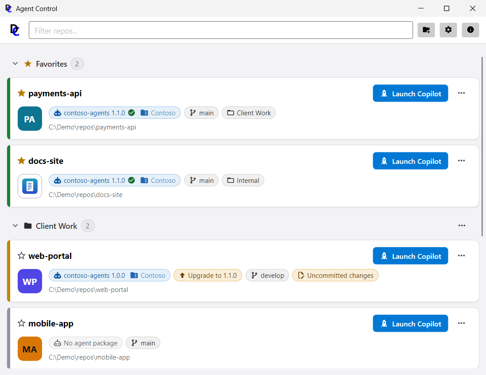

# Introduction

## Purpose

Agent Control is a Windows desktop launcher application that lets a company distribute
proprietary AI-agent configuration (Copilot/agentic-CLI instruction files, standards,
templates, and skills) alongside public source repositories, without ever committing that
proprietary content to source control. A developer opens a repo from a recent-repos list,
has AgentControl ensure the repo's `.github/agents`, `.github/standards`,
`.github/templates`, and `.github/skills` folders match the version pinned in that repo's
`.agentcontrol.json` file, optionally pulls the latest commits, and then launches their
preferred agentic CLI tool (for example, GitHub Copilot CLI) in that repo's working
directory.

The figure below shows how the pieces fit together: the developer works in the launcher window, whose view-models
coordinate the subsystems that fetch a package version from a package source, extract its agent folders into the
repo and record the pin, and launch the agentic CLI tool, with git run as the user's own subprocess.


## Scope

This user guide covers:

- Installing AgentControl
- The main window: the app bar, the repo cards, and the light and dark themes
- Adding a repository to the recent-repos list
- Reading a repo card's chips: pinned package, upgrade, branch, and status warnings
- Configuring package sources (zip-package folders, NuGet-package folders, NuGet-package
  servers and Git repositories), including testing a connection and signing in
- Why a published package version should never be reused, and how to guard against it
- Selecting an initial agent package for a never-pinned repo, changing the package or version of a pinned repo,
  and upgrading an already-pinned repo
- Launch behavior, including ensure-synced-before-launch semantics
- Pulling the latest commits for a repo
- Configuring per-user settings (package sources, git executable, agent tool, shell)
- The About dialog
- Authoring agent packages (zip files, NuGet packages and tagged Git repositories) so AgentControl can discover and
  apply them

# Installation

AgentControl is distributed as a Windows MSI installer, built from
`src/DemaConsulting.AgentControl.Msi/`.

1. Download the latest `AgentControl-{version}.msi` release.
2. Run the installer and follow the prompts.
3. Launch **AgentControl** from the Start menu.

Running an AgentControl installer always replaces the AgentControl that is installed - an upgrade, a reinstall of
the same version, or an older version (a downgrade) - so there is only ever one installed copy.

The installed application is **self-contained and single-file**: it bundles its own copy of
the .NET 10 runtime (matching the app's `net10.0` target framework and the Avalonia UI
framework's Windows desktop requirements), so the target machine needs no pre-installed
runtime.

# The Main Window


The top of the main window is one compact **app bar** below the window's normal title bar. From left to right it
holds:

- the AgentControl **logo** (hover for its name; the name and a short description are in the **About** dialog),
- the **filter box**, which stretches across the bar and narrows first when the window is made narrower (it is
  also the first stop when you press **Tab**), and
- three icon buttons: **Add repository** (a folder with a plus), **Settings** (a gear) and **About** (an
  information mark), each with a tooltip.

Below the app bar is the list of **repo cards**, described in the next section, newest-launched first within each
section (see *Organizing Repos with Groups*). With no repos, or when the filter matches none, a short message
says so instead.

AgentControl follows your operating system's light or dark setting by default, and every window works in both
themes; to always use one of them, choose a **Theme** in Settings (see *Settings*).



# Adding a Repository

Click the **Add repository** button (the folder-plus icon) in the main window's app bar. A folder-browse dialog
opens; select the root folder of the git repository you want to manage. The repo is added to the
recent-repos list as a card.

Each repo card shows:

- A colored **status bar** on the card's left edge: **green** — an agent package is pinned and no newer
  version is available; **amber** — an upgrade is available; **red** — something needs attention (the folder is
  missing, the package source has a problem or needs a sign-in, or the last action you started on the card
  failed); **grey** — no agent package is pinned (or the upgrade check is still running). Color is never the
  only signal: hover the bar for the status and its reason, and the chips below say the same in words.
- On the first line, the **favorite star** (click it, or press Space on it, to pin the repo above the default
  most-recently-launched sort order, and click it again to unpin it; it is a gold filled star when favorited and an
  outline otherwise) and
  the repo's name (its folder name) right beside it
- On the same line at the right, the **Launch** button, labeled with your agent tool (see *Launching*), and a
  "..." menu
- Below the first line, the repo's **picture tile** (see *Giving a Repo a Card Icon*) beside a row of **chips** —
  small rounded labels, each with a hover tooltip that explains it in full (see *Reading the Chips* below) —
  and, in smaller muted text below them, the repo's full path. When the window is narrow a long name is
  shortened at its end and a long path in the middle, so the repo's own folder name at the end of the path stays
  visible (hover over either for the full text)
- The "..." menu is grouped. **Repository**: **Git Pull** (see *Pulling Changes*) and **Refresh** (re-checks
  the repo's git state, upgrade status and committed-agent-files chip without waiting for the next app
  launch, and re-reads all your package sources - NuGet, zip folders and Git repositories - so that a newly
  published version or pushed tag shows up at
  once; for a repo whose folder is missing it reads **Check again** and checks whether the folder is
  available again). **Agent files**: **Select Package...** (a repo with no package yet), **Change package...** (a
  repo that already has one) and **Upgrade to x.y.z** (when a newer version exists); the group is hidden when none
  of them applies - see below. **Organize**: **Move to group** and **Card color...** (see
  *Organizing Repos with Groups* and *Choosing a Card Color*). Then **Remove from list**.


Removing a repo from the list prompts for confirmation first, since it is a destructive
action against AgentControl's own recent-repos state (it does not touch the repository
itself).

## Giving a Repo a Card Icon

Instead of the colored tile with the repo name's first letters, a card can show your repository's own picture.
Put a PNG file named `icon.png` (or, if there is no usable `icon.png`, `logo.png`) in the **root folder** of the
repository - the name's letter case does not matter. AgentControl looks for it when it starts and whenever you
choose **Refresh** in the card's "..." menu, and shows it, scaled down, inside the same rounded tile (a wide or
transparent logo is centered on a light background so it stays tidy). A repository can be untrusted, so the
picture is only used when it is a plain file (not a link) of at most 1 MB that really is a PNG image of a
reasonable size; anything else is ignored and the colored tile stays. Pictures in folders below the root are never used.

## Organizing Repos with Groups

When you track many repos, put related ones into **groups** of your own. Groups (and the card colors below) are
personal: they are stored only in your own AgentControl settings file and are never written to a repository or to its
`.agentcontrol.json`, so they are not shared with anyone through git, and a repo is in at most one group.

1. Open the repo card's "..." menu and choose **Organize > Move to group**.
2. Pick one of your existing groups (the repo's current group has a check mark), or choose **New group...**. The
   small prompt checks the name as you type: it must not be blank, may have up to 40 characters, and may not be
   **Favorites** or **Ungrouped** (those are the built-in sections). Typing the name of an existing group in
   another letter case simply adds the repo to that group. **Create** stays disabled until the name is usable.
3. To take a repo out of its group, choose **Remove from group** in the same submenu.

As soon as one repo is in a group the list is shown in **sections**, each with a header that shows the section's
name and how many repos it holds:

- **Favorites** comes first and holds your starred repos. A favorite is listed **only** here, not again under its
  group, so every repo appears once; its card shows its group as a small chip, and it returns to its group when you
  remove the star.
- Then come **your groups**, alphabetically (letter case ignored), and finally **Ungrouped**, the repos in no group.
  A section with no repo has no header. Within a section the most recently launched repo comes first.

Click a header (its chevron, name or count) to **collapse** or **expand** the section; AgentControl remembers which
sections you collapsed. A group's header also has a "..." menu. Its first item, **Add repository...**, opens the same
folder picker as the **Add repo** button in the app bar and puts the folder you choose straight into that group (if
the repo is already in the list, it is moved into the group and a message tells you so; if you cancel the picker,
nothing changes). After a separator come **Rename group...** (the same prompt; another
group's name is refused) and **Remove group**, which asks for confirmation and leaves the group's repos in the
list, ungrouped. Nothing on disk changes. The built-in **Favorites** and **Ungrouped** headers have no menu.


The **filter box** always searches all repos: while it has text, every section is shown expanded and a section
without a match disappears, so a repo is never hidden inside a collapsed group; clear the filter and your collapsed
sections are back as you left them (the headers' toggles are disabled while filtering). While no repo is in a group
there are no headers at all, and favorites simply come first.

## Choosing a Card Color

Choose **Organize > Card color...** in a card's "..." menu to color that repo's tile. A small palette opens under
the "..." button with ten colors (blue, violet, magenta, green, amber, teal, orange, indigo, red and lime) that look
right in both the light and the dark theme; the chosen one shows a check mark. **Automatic** goes back to the color
AgentControl derives from the repo's path. The letters on the tile are white or near-black, whichever is easier to
read on that color (at least 4.5:1 contrast in both themes). A repo that shows its own picture (see *Giving a Repo a
Card Icon*) keeps the picture's light backing so the picture stays legible, and the color appears as a ring around
it. The **status bar** on the card's left edge never changes with the color: green, amber, red and grey keep their
meaning.


## Reading the Chips

- **Agent package chip** (robot icon) — the agent package the repo is pinned to and its
  version, for example `contoso-agents 1.0.0`. Beside the version, a small icon shows the kind of
  source that currently supplies the files (a folder of zips, a folder of NuGet packages, a NuGet server or a Git
  repository) and that source's **alias** is shown as muted text next to it, so you can see where the files
  come from without hovering. The icon and the alias are left out when no source of yours is known to supply the
  files. The tooltip names the source in full: "Agent files: contoso-agents 1.0.0 from source 'Default' (zip
  folder)." For a Git repository the tooltip also names the tag, for example "Agent files: contoso-agents 1.0.0 from
  source 'Contoso' (git repository), tag v1.0.0." The source shown is one of **your** configured sources that delivers
  the files the repo was set up with, whatever it is called on a teammate's computer (see *Sharing a Repo With a
  Team*). When the pinned
  package is the newest one available, a small green **check mark** inside the chip (tooltip "Agent files are
  up to date") says so, in addition to the green bar on the card's left edge; it is not shown while an upgrade is
  available, while AgentControl is still checking, or when there is a problem.
- **Upgrade chip** (amber, up arrow) — **Upgrade to** and the version an upgrade would move to, for example
  `Upgrade to 1.1.0`. It appears only when one of your configured sources offers a newer version of the package (the
  newest one across all of them). **Click
  the chip** (its tooltip says "Upgrade the agent files to 1.1.0"), or use the card's "..." menu >
  **Upgrade to 1.1.0**, to apply it: both do exactly the same thing, with the same confirmations, and both are
  unavailable while another operation is running on the card. While AgentControl is still checking the
  source, the chip is not shown yet (the card shows "checking for updates..."); a slow or unreachable
  source never blocks the window.
- **No agent package chip** (grey) — the repo has no pin yet. Click it, or use "..." > **Select
  Package...**, to choose one.
- **Branch chip** — the repo's current git branch.
- **Uncommitted changes** (amber) — the repo has uncommitted local changes; this disables the
  **Git Pull** action for that card.
- **Committed agent files** (amber) — one or more of `.github/agents`, `.github/standards`,
  `.github/templates`, `.github/skills` are tracked by git in this repo. For **Launch** this is purely
  advisory: Launch never changes git tracking state, it only warns that content meant to stay untracked (via
  `.gitignore`) appears to have been committed, and skips the agent-package sync. **Select Package...**, **Change
  package...** and **Upgrade** instead offer to *convert* the repo: after you confirm, AgentControl stops git
  tracking those folders and manages them from the package (see *Repos with Committed Agent Files* below). They
  also ensure your `.gitignore` covers the four folders, which keeps them out of git from then on.
- **Folder missing** (red) — the repo path no longer exists on disk (for example, a deleted
  folder or an unmounted network/removable drive). This suppresses the card's other chips and
  actions, and offers a "Remove from list" action instead (the card is never auto-removed, since
  the path may reappear, such as a drive being remounted). When the folder is back, choose the card's "..." menu >
  **Check again**; the badge goes away and the card's actions return, without restarting AgentControl.
- **Package source problem** (red) — the package the repo is pinned to cannot be obtained from your configured
  sources. The tooltip states which of two problems it is. "No configured source offers contoso-agents 1.0.0. Add a
  source that delivers it in Settings, or use Change package... to select the package from a configured source."
  means that none of your sources (or no source at all) lists that version - for example the source was removed, or a
  feed deleted old versions. "No configured source delivers contoso-agents 1.0.0 with the files this repo was set
  up with" means that some source lists the version, but its files are not the ones the repo was set up with: the
  package may have been republished (see *Version Immutability and Trust*). A source whose files are not proven
  identical to the recorded ones is never used. A repo
  whose pin has no recorded fingerprint (written by an older AgentControl) has nothing to check, so it is never
  refused for that reason. A newer version that one of your sources offers is **still** offered as an **Upgrade**,
  which is the way out of either problem (the tooltip then ends "Upgrade to 1.1.0 to move to a version a
  configured source offers."), so the red chip and the amber upgrade chip can be shown together. When one of your
  sources *does* deliver the identical files, there is no problem: the package chip names that source instead (see
  *Sharing a Repo With a Team*).
- **Sign-in needed** (red) — a server or a Git repository of yours needs a sign-in, and the
  background check never asks. Use the card's "..." menu > **Refresh** to sign in (see *Signing In* and *Adding a
  Git Repository*).

Below the chips, a card shows the outcome of the last action you started on it - for example the reason a
**Git Pull** failed - in small text under the repo's path (hover for the full text).

# Package Sources

AgentControl takes agent packages from one or more **package sources**, which you manage in
Settings. Four kinds of source are supported:

- **Zip-package folder** — a folder (local, mapped drive, or UNC share) holding agent package
  zip files named `{package-name}-{version}.zip`.
- **NuGet-package folder** — a folder (local, mapped drive, or UNC share) holding `.nupkg`
  files, as a NuGet "folder feed" does. A feed folder cannot be listed cheaply, so you also give
  the **package IDs** it offers.
- **NuGet-package server** — a NuGet feed served over the web, such as JFrog Artifactory or Azure
  Artifacts. You give its **feed address** and, as for a folder, the **package IDs** you want from it.
  A server may need you to sign in (see *Signing In*).
- **Git repository** — one Git repository (https, SSH, or a local or UNC path) that delivers **one package**,
  whose versions are the repository's **tags** (for example `v1.2.0`). It uses your own Git installation and
  sign-in (see *Adding a Git Repository*).

Each source has an **alias**, the short name shown in the app. An alias belongs to **your** configuration only: a
repo's pin does not record it, so teammates can call the same source anything they like.

## Adding a Source

1. Open Settings (the gear icon) and, above the **Package sources** list, click **Add** and choose
   **Zip-package folder**, **NuGet-package folder**, **NuGet-package server** or **Git repository** from the menu
   (each item shows its icon and a one-line description; see *Adding a NuGet-Package Server* and *Adding a Git
   Repository* for the last two).
2. Type an **alias** - the name shown for this source on repo cards. It must be unique (letters are compared ignoring
   case) and cannot be changed later.
3. For a folder, enter the **location** as a full folder path, or use **Browse** to pick the
   folder. A location that contains a user name or password is refused, and so is a web address
   (a web address is a server, which has its own button).
4. For a NuGet-package folder, enter each package ID and click **Add**; at least one is required.
   A NuGet source (folder or server) also has a **Package signatures** section, where you can require signed
   packages (see *Requiring Signed Packages*). A Git repository has its own fields (see *Adding a Git
   Repository*).
5. Messages under each field say what is wrong, and **Save** stays disabled until everything is
   valid. Then save the source, and save the Settings window to keep the change.


Each row of the list shows the alias, an icon for the kind of source, the location (hover for
the full text) and a status. For a folder (or a Git repository given as a local path) the status is whether the
folder can currently be found, checked in the background so an offline network share never freezes Settings. A
server or a remote Git repository shows a neutral **Online source** status with a cloud icon: AgentControl
contacts it only when it needs it - when you select a package, check for upgrades, sync at launch or press
**Test connection** - never just to draw the list, because
that could mean a wait, or a sign-in, for a window you only opened to look. A NuGet source (a folder or a server)
that requires signed packages also shows a small **Signed only** badge with a shield; hover over it to see that
signed packages are required and, when you pinned a publisher, that only that publisher is accepted (shown by the
start and end of its certificate fingerprint).

The Settings window and the package source editor windows can be **resized** (drag an edge or corner): paths and
feed addresses can be long, so the fields and the source list widen with the window and show more of the text, and a
window made shorter than its content scrolls while **Save** stays in view. The windows reopen at their usual size.

## Adding a NuGet-Package Server

Click **Add** and choose **NuGet-package server**. The dialog is a stack of titled sections - **Source**, **Packages**,
**Sign-in**, **Package signatures** and **Connection test** - and scrolls when the screen is short, while its
**Cancel** and **Save** buttons stay in view at the bottom. The **Source** section asks for:

- **Alias** — as for any source.
- **Feed address** — the address of the feed's NuGet V3 **service index**. It must start with
  `https://` and end in `index.json`, and it must not contain a user name, password, query string
  or fragment. Typical addresses:

  ```text
  JFrog Artifactory: https://<host>/artifactory/api/nuget/v3/<repo>/index.json
  Azure Artifacts:   https://pkgs.dev.azure.com/<org>/_packaging/<feed>/nuget/v3/index.json
  ```

- **Allow insecure HTTP** — off by default. A plain `http://` address is refused until you tick it,
  and ticking it shows a warning: anything you type into the sign-in dialog for that server would
  cross the network unprotected. Tick it only for a feed on a network you trust (for example a
  test server on your own machine).
- **Package IDs** (the **Packages** section) — the packages you want from this server, at least one. A server cannot be
  listed cheaply, so you name the packages. Package IDs use the same names as the NuGet packages
  themselves.
- **Sign-in** — explains when AgentControl asks you to sign in and holds **Forget saved sign-in** (see
  *Remembering a Sign-In*).
- **Package signatures** — see *Requiring Signed Packages*.
- **Connection test** — see *Testing the Connection*.


## Testing the Connection

Before saving a server, click **Test connection**. It becomes available once the address is
acceptable and at least one package ID is listed. AgentControl asks the server for the versions of
the **first** package ID in your list - it reads only the version list and downloads no package, and it
saves no package or source setting. A sign-in you type during the test is handled as for any other
sign-in: kept for this session, and saved by your Git credential helper only if you tick the
remember option (see *Signing In* and *Remembering a Sign-In*). While it works you see progress and a
**Cancel test** button (separate from the dialog's own **Cancel**; a server that has to refuse a
credential first can take several seconds to answer). The result tells you in words what happened:

- **Connection OK** — the server answered and has the package; the number of versions found and the
  latest one are shown.
- **Sign-in failed** — the server needs a sign-in or refused the one given (HTTP 401): the user name,
  password or token is wrong.
- **Access denied** — you are signed in, but the server refused access (HTTP 403) and says why, for
  example that your account lacks the **ReadPackages** permission on the feed. No sign-in dialog opens,
  because a different password cannot fix a missing permission - see *Troubleshooting a Server Source*.
- **Sign-in canceled** — you closed the sign-in dialog without signing in.
- **Package not found** — the server answered, but it has no package with that ID. Check the ID, and
  that your account may see it.
- **Timed out** — signing in took longer than the allowed time (see *Signing In*).
- **Server unreachable** — the server could not be reached, or the address did not answer as a NuGet
  feed. Check that the address ends in `index.json` and that the server is reachable from your
  machine.
- **Connection failed** — anything else; the message says what.

The test may open the sign-in dialog, exactly as selecting a package would. If you change the
address, the insecure-HTTP tick or the package IDs, the last result is cleared, because it described
the old values.

## Requiring Signed Packages

A **NuGet-package folder** or **NuGet-package server** source can insist that every package it supplies
is **validly signed**. An agent package changes the instructions your AI agent follows in a repo, so this
is how an organization decides who may publish what reaches those repos. In the source's dialog, under
**Package signatures**:

- **Require signed packages** — off by default. When it is on, AgentControl never installs a package from
  this source that is unsigned, whose signature is invalid, or whose signer your computer does not trust.
  The check is made **every time** a package is used, including one AgentControl downloaded earlier, so
  turning the option on later, or changing the fingerprint, takes effect immediately.
- **Trusted signer certificate fingerprint (SHA-256)** — optional, and **recommended**. Without a
  fingerprint, *any* validly signed package that chains to a certificate authority your computer trusts is
  accepted, including a package signed by an unrelated publisher. With a fingerprint, only packages signed
  by that publisher are accepted. The field is usable only while the checkbox is ticked. Paste the
  fingerprint as you find it - 64 hexadecimal characters, in upper or lower case, with or without colons,
  dashes or spaces; AgentControl saves it in one normalized form, and a value that is not a SHA-256
  fingerprint is reported and stops you saving.

**What the fingerprint is.** It is the SHA-256 fingerprint of the package **author** certificate - the
certificate of the publisher who signed the package, not the repository countersignature that a feed such
as nuget.org adds. Pinning the repository's certificate therefore does not match, and the package is
refused. To find the fingerprint of a package you trust, run

```text
dotnet nuget verify --all contoso-agents.1.2.0.nupkg
```

and read the **SHA256 hash** printed under the *Author* signature's signer certificate; a certificate viewer
on the signing certificate shows the same value as its SHA-256 (thumbprint) fingerprint.

**Your own NuGet settings are ignored for this.** The trusted signers you may have configured in your
user-level or machine-level NuGet configuration neither add publishers to nor remove the pinned publisher
from what a source accepts; the source's own dialog decides alone. A **zip-package** folder has no signature
requirement, because a zip file carries no signature.

**When a package is refused.** The upgrade or selection stops, nothing is installed, the repo is left as it
was, and a message names the package and the source. For a source with no pinned publisher it reads *"Package
'contoso-agents' 1.2.0 from source 'Feed' is not validly signed, but the source requires signed packages. It
may be unsigned, its signature may be invalid, or its certificate may not be trusted on this computer."* For
a source with a pinned publisher it reads *"... is not signed by the trusted publisher (certificate
A3AF7AF1…7641). It may be unsigned, signed by someone else, or its signature may be invalid."* - only the
start and end of the fingerprint are shown. A repo card whose package comes from a source that requires signatures
shows a small
**shield** in its package chip; hover over it to see whether any trusted signer is accepted or the signer is
pinned.

**Platforms.** Signature verification works on Windows, Linux and macOS. On any other platform the checkbox
is **disabled** and hovering over it says *"Package signature verification is not supported on this
platform"*; and if a settings file that was edited by hand requires signatures there anyway, AgentControl
refuses to list or supply packages from that source - it **fails closed** - rather than silently skipping
the check.

**Certificates and revocation.** Verification needs the computer to trust the certificate chain of the
signer, which on Windows, macOS and most Linux systems means the operating system's trust store. A package
signed with a certificate from a private authority needs that authority in the trust store. NuGet also
checks whether certificates have been revoked, which needs network access to the certificate authority; on a
computer that is offline, or behind a firewall that blocks it, verification of an otherwise good package can
fail, in which case the message above is shown.

**Signing your own packages** (for authors): sign a package with a code-signing certificate, then publish it.
Sign with the same certificate every time, so the fingerprint your consumers pin stays valid until the
certificate is renewed:

```text
dotnet nuget sign <package>.nupkg --certificate-path <signing.pfx>
    --certificate-password <password> --timestamper <timestamp-server-url>
```

(One command, shown on two lines.)

## Signing In

When a server needs credentials for something you started - **Test connection**, **Select
Package...**, **Upgrade**, or a card's **Refresh** - AgentControl opens a **sign-in dialog** over the
window you were using. It shows:

- the **server that will receive what you type** (for example `https://pkgs.dev.azure.com`) in large
  text, so you can check it is the server you meant;
- the alias of the source it is for;
- a warning when the server uses plain `http` (what you type is not encrypted), and a notice when the
  credential you gave last time was rejected;
- a **user name** box and a masked **password or token** box (for Azure Artifacts, use a personal
  access token as the password);
- the sentence **"Used for this session only - AgentControl does not save it."**;
- a **"Remember on this computer (saved by your Git credential helper)"** checkbox, unticked by default
  (see *Remembering a Sign-In*). Ticking it changes the sentence to **"Saved by your
  Git credential helper on this computer - AgentControl does not store it."**

**Sign in** is enabled only when both boxes are filled. **Cancel**, pressing Escape or closing the
window all mean "do not sign in". What happens next:

- **Wrong user name or password** — the server refuses it, AgentControl forgets it, and the operation
  reports *Sign-in failed*. It asks only once per operation and never loops; start the action again
  (for example with **Retry** in the Select Package dialog) to get a fresh dialog, which tells you the
  last attempt was rejected.
- **Cancel** — the operation stops with *Sign-in canceled*; nothing is remembered.
- **Taking too long** — if the sign-in is not completed within **2 minutes** AgentControl stops the
  operation and reports *Timed out*, so an abandoned dialog never holds anything up forever.
- **Success** — the credential is remembered **in memory for the rest of this session**, so the next
  operation on the same server (selecting a package after testing the connection, for example) does
  not ask again. It is forgotten if the server ever rejects it, and when you close AgentControl - unless
  you ticked **Remember on this computer**.

Only one sign-in dialog is shown at a time; if two sources need one at once, the second waits for the
first.

**Background checks never open the dialog.** When AgentControl starts, after you change Settings, when
you add a repo, and then every five minutes while AgentControl stays open (see *How Up to Date the Lists Are*), it
checks each repo's package against your configured sources for upgrades in the background.
For a server
that needs a sign-in, that check uses a credential you already typed this session (or saved, see below)
and otherwise does
**not** ask: the card shows a **Sign-in needed** chip. Use
the card's "..." menu > **Refresh** (or Select Package / Upgrade) - actions you start - to sign in.

## Troubleshooting a Server Source

- **"Signed in, but '<server>' refused access: ..."** (headline *Access denied*) — the server knows who
  you are (for example your Windows account on an on-premises Azure DevOps Server) but your account may
  not read this feed. AgentControl does not ask you to sign in again, and does not forget a saved sign-in,
  because neither can help. The message repeats the reason the server gave. Ask the feed's administrator
  to give your account the **Reader** role on the feed (on Azure DevOps this includes **ReadPackages**);
  then choose the card's "..." menu > **Refresh**.
- **"... needs a sign-in"** or **Sign-in failed** — the server wants a user name and password or token; sign
  in as described above.
- **Server unreachable** — check the address (it ends in `index.json`) and your network.

## Remembering a Sign-In

By default AgentControl keeps what you type for the current session only. If you do not want to type a
token every time you start AgentControl, you can **opt in, for one sign-in at a time**, by ticking
**Remember on this computer (saved by your Git credential helper)** in the sign-in dialog.

**AgentControl never stores the secret itself.** It hands the sign-in to your **Git credential helper** - the
program Git already uses on your computer to keep the passwords for your Git remotes - and asks it for the
sign-in again when it is needed:

- On **Windows** the helper is normally **Git Credential Manager**, which keeps the secret in the **Windows
  Credential Manager** (look for an entry named like `git:https://<host>`).
- On **macOS** the helper keeps it in the **keychain** (Git Credential Manager or the `osxkeychain` helper).
- On **Linux** it is usually **libsecret** (the GNOME keyring or another *secret service*) or Git Credential
  Manager; a plain `credential-store` helper keeps it in a **file** (`~/.git-credentials`) that is not
  encrypted, so prefer a helper that uses the system keyring.

To see whether a helper is configured, run `git config credential.helper` in a terminal; it prints the helper's
name (for example `manager`, `osxkeychain` or `libsecret`). If it prints nothing, no helper is configured, and
the checkbox is **disabled** with a tooltip that says so (hover over it); install Git with a credential helper
(for example Git Credential Manager) to enable it. A helper that is configured only for some hosts counts as
available only for those hosts.

How it works, so there are no surprises:

- **Off by default**, and decided each time you sign in. Nothing is saved unless you tick the box, and only
  **after the sign-in worked**: a wrong password is never saved.
- **What is read.** When a server needs a sign-in, AgentControl asks the helper for an entry for that server's
  exact **scheme, host and port** (for example `https://pkgs.dev.azure.com`), **once per server per session**,
  without any dialog - also for the background checks - and never for any other server. If the helper has
  nothing, you are asked as usual.
- **A saved sign-in that stops working** (for example the token expired) is **removed** from the helper when
  the server rejects it, and you are asked once.
- **No window from Git.** AgentControl runs Git with prompts disabled and gives it ten seconds, so a helper
  that wants to ask something simply counts as "nothing saved".

**Forget saved sign-in.** To remove a saved sign-in yourself, open the server source in Settings (**Edit**) and
click **Forget saved sign-in**. AgentControl asks you to confirm, naming the server, then removes the sign-in
from your Git credential helper and from this session, and tells you the result: it was forgotten, there was
nothing saved, or the helper could not remove it. The button is disabled, with a tooltip, when no Git
credential helper is configured for the server (nothing can have been saved then) or while AgentControl is
still checking. You can always remove the entry with the helper's own tools instead - for example
delete the `git:https://<host>` entry in the Windows **Credential Manager**, remove the item from the macOS
**Keychain Access**, or delete the entry from your Linux keyring.

## Where Credentials Come From

For a server, AgentControl looks for credentials in this order and asks you only as a last resort:

1. **What NuGet itself already knows.** If your own NuGet configuration (`nuget.config`) lists a
   source whose address is the same as the source's feed address (letters and a trailing slash are
   ignored), the credentials stored there are used. Installed NuGet **credential providers**, such as
   the Azure Artifacts Credential Provider, are also run, but only without interaction (they can sign
   in silently, for example with your Windows or Visual Studio identity, but never open a window of their
   own). A configuration entry for an Azure Artifacts feed looks like this:

   ```xml
   <configuration>
     <packageSources>
       <add key="Contoso" value="https://pkgs.dev.azure.com/contoso/_packaging/agents/nuget/v3/index.json" />
     </packageSources>
     <packageSourceCredentials>
       <Contoso>
         <add key="Username" value="you@contoso.com" />
         <add key="ClearTextPassword" value="YOUR_PERSONAL_ACCESS_TOKEN" />
       </Contoso>
     </packageSourceCredentials>
   </configuration>
   ```

   Replace `YOUR_PERSONAL_ACCESS_TOKEN` with your own token. Put it in your user-level NuGet
   configuration (`%AppData%\NuGet\NuGet.Config`). The
   `dotnet nuget add source` and `dotnet nuget update source` commands can create and update such an
   entry for you (with `--username` and `--password`; add `--store-password-in-clear-text` where the
   platform cannot encrypt it). Credentials stored in your NuGet configuration are yours to protect -
   AgentControl only reads them. AgentControl never reads or writes the `nuget.config` of a repo.
2. **A credential you already typed in this session, or one you saved earlier with "Remember on this
   computer"** (kept by your Git credential helper; see *Remembering a Sign-In*).
3. **The sign-in dialog**, at most once per operation, and only after the server has refused the
   first two.

A credential is only ever sent to a server when that server asks for it (an HTTP 401 answer) -
AgentControl never sends one ahead of time - and AgentControl offers it only to the server it was
for. A different server, a different port, or an address the first server redirects to is never given
your credential by AgentControl and never causes a sign-in dialog.

## Only Add Servers You Trust

AgentControl itself only ever offers your credential to the feed address you configured. There is one
limit it cannot remove: a feed's own index says where its package resources live, and once a server has
authenticated, the NuGet client answers sign-in challenges from other hosts that the index names with
the same credential. In testing, a second server named by a feed's index received an `Authorization`
header. So **add only servers you trust**, because the feed you add decides where package downloads
are requested from. If you do not trust a feed's operator, do not sign in to it.

## Adding a Git Repository

A **Git repository** source delivers **one package** from **one repository**: the package's versions are the
repository's **tags** that match a pattern you choose, and a version's files are the package layout (see
*Authoring a Git Package*) as it was at that tag. Use it when your team already keeps its agent files in a Git
repository: tagging a release publishes it, with no zip or NuGet package to build.

Click **Add** and choose **Git repository**. The dialog is a stack of titled sections - **Source**, **Package**,
**Versions**, **Location in repo**, **Sign-in** and **Connection test** - and scrolls when the screen is short.


### Source, package and versions

- **Alias** — as for any source: unique, and fixed once the source is saved. The repo cards that get their files from
  this source show the alias in the package chip.
- **Repository URL** — where the repository is. Three forms of address are accepted, plus a local path:

  ```text
  https:       https://host/org/repo.git
  SSH:         git@host:org/repo.git
               ssh://git@host/org/repo.git
  Local path:  C:\Demo\agent-packages.git   or   \\server\share\agent-packages.git
  ```

  For a local path you can also use **Browse**. An address with a user name and password or a token in it is
  refused (AgentControl never stores credentials; see *Signing In to a Git Repository*), and so are other
  transports: plain `http://`, `git://` and remote helpers such as `ext::` are never used.
- **Package name** (the **Package** section) — the name this package has in Select Package and on repo cards. Leave
  it empty to use the alias (when the alias is a valid package name: letters, digits, `.`, `_` and `-`).
- **Tag pattern** (the **Versions** section) — which tags are versions. The text `{version}` stands for the version
  and everything else must match the tag **exactly**. The default is `v{version}`. Examples:

  | Pattern | Finds a tag such as | Version |
  | :--- | :--- | :--- |
  | `v{version}` (default) | `v1.2.3` | 1.2.3 |
  | `release/V{version}` | `release/V1.2.3-beta.1` | 1.2.3-beta.1 |
  | `ver{version}` | `ver1.2.3` | 1.2.3 |

  The version part must be a strict SemVer: three numbers without leading zeros such as `1.2.3`, optionally with a
  prerelease such as `1.2.3-beta.1`. A tag with build metadata (`v1.2.3+build.5`), with two or four numbers, with a
  leading zero (`v01.2.3`) or without a version is **ignored**. The fixed parts of the pattern are **case-sensitive**:
  `V{version}` does not find `v1.2.3`, and
  `v{version}` does not find `V1.2.3`. The box checks the pattern as you type and says what is wrong.
- **Folder (optional)** (the **Location in repo** section) — if the package layout is not at the top of the
  repository but in a subfolder (for example `packaging/agents`), enter that folder; the `.github` folders,
  `release-notes.md` and `AGENTS.md` are then taken from it. Leave it empty for the top of the repository.

**Save** stays disabled until the alias, the address, the package name, the pattern and the folder are all valid.

### Testing the connection

Click **Test connection** to try the source before saving it. AgentControl **lists the repository's tags without
cloning it** (nothing is downloaded but the list of tags), and shows which tags match your pattern. While it works
you see progress and a **Cancel test** button. The result says in words what happened:

- **Connection OK** — the repository answered and has tags that match. A summary such as "4 of 17 tags match the
  pattern" and the newest matching versions (each with its tag name) appear, and the newest version is named.
- **No matching tags** — the repository answered, but no tag is a version under your pattern (or it has no tags
  yet). The message shows a few tags the repository **does** have and reminds you to check the prefix and the
  capitalization of the pattern - the fixed parts are case-sensitive - and that the version part is three numbers
  such as `1.2.3`.
- **Sign-in needed** — the repository wants a sign-in that AgentControl could not complete (see *Signing In to a Git
  Repository*).
- **Repository not found** — the address is wrong, or your account may not see the repository.
- **Repository unreachable** — the server could not be reached (for SSH this includes a host key that is not
  trusted yet; the message says how to fix it).
- **Timed out** — Git did not answer in time and was stopped.
- **Git is too old** — AgentControl needs Git 2.29 or newer (see *Git on Your Computer*).
- **Connection failed** — anything else; the message says what.

If you change the address, the pattern, the folder or the package name, the last result is cleared, because it
described the old values.

### Signing In to a Git Repository

AgentControl **never stores credentials** for a Git repository and never shows its own sign-in dialog for one; it uses
the sign-in your own Git setup already provides:

- **https** — your Git credential helper (on Windows normally **Git Credential Manager**). If it needs to ask you,
  it shows its own window.
- **SSH** — your own SSH keys, or the keys in your **ssh-agent**. AgentControl runs `ssh` without any prompt, so the
  key must work **without a passphrase prompt** (load it into ssh-agent first), and the server's **host key must
  already be trusted**: connect once from a terminal (for example `ssh git@host`) and accept the host key. AgentControl
  never accepts a host key on your behalf.
- **Local path** — the file permissions of your own account.

Sign-in may be asked for only when **you** start the action: **Test connection**, **Select Package...**,
**Change package...**, **Upgrade** and the card's **Refresh**. The background checks AgentControl makes (at start,
after you change Settings and when you add a repo) **never prompt**. When one needs a sign-in, the repo's card shows a
red **Sign-in needed** chip; sign in with Git as above, then choose the card's "..." menu > **Refresh**.

### Git on Your Computer

A Git repository source runs the `git` program installed on your computer - the same one used for **Git Pull** -
and needs **Git 2.29 or newer**. With an older Git, **Test connection** and the other actions report **Git is too
old** and say which version was found. Install a newer Git, or set **Git executable path override** in Settings (see
*Settings*) to a newer `git`.

### What Git Does and Never Does

AgentControl runs Git with a locked-down command line, because the contents of a repository are not trusted:

- It **lists** tags (no clone), and to apply a version it **fetches just that tag, one commit deep**, and then reads
  **only the package layout** straight from the fetched commit - nothing is checked out: the four managed folders
  (`.github/agents`, `.github/standards`, `.github/templates`, `.github/skills`), `release-notes.md` and `AGENTS.md`
  (inside the configured folder, if any). Each file is written exactly as the commit holds it (no line-ending
  conversion, no filters). Nothing else in the repository is read or written.
- It **never runs hooks**, never initializes or updates **submodules**, never runs **Git LFS** filters, and never
  uses **remote helpers** (such as `ext::` or `fd::`). Only https, SSH and a local path are allowed - never plain
  `http` or `git://`.
- A **symbolic link or submodule** inside the package layout makes AgentControl refuse that version, and the
  `.git` folder is **never copied** into your repo.
- The fetched files are **cached** per repository and commit in AgentControl's own folder under your local
  application data (the last few commits per repository are kept), so a version already used on this computer is
  applied again without the network.
- It does not change your Git configuration, and it does not override Git's safety checks (for example "dubious
  ownership" is reported, not bypassed).

### Where Git Sources Are Recorded

Like the other kinds, a Git source is saved in your `settings.json` (see *What Is Stored*). A repo's pin records the
package name, the version and a fingerprint of the agent files - not the source, the tag or the commit - see
*Version Immutability and Trust* for what happens when a tag is moved.

On a repo card, the package chip of a repo whose files come from a Git repository shows the Git icon and the alias of
your source that supplies them:


## Editing and Removing a Source

Select a row and click **Edit** (the **Edit** and **Remove** buttons sit above the list and act on the
selected row) to change its location (a server's feed address and insecure-HTTP
choice, a Git repository's address, tag pattern, folder and package name) or (for NuGet) its package IDs; the alias
is fixed, and a server opens the same dialog as when
adding, including the **Sign-in** section with **Forget saved sign-in** (see
*Remembering a Sign-In*), the signature options and **Test connection**; a Git repository opens the Git dialog
(see *Adding a Git Repository*).
**Remove** asks for confirmation. Removing a source is allowed
even when repos get their agent package from it, but the confirmation tells you how many do: "N repo(s) get its agent
package from 'Contoso'. Without it those repos use another configured source that delivers the identical files; if
there is none they will show a "Package source problem"." (see *Sharing a Repo With a Team*).

## What Is Stored

Sources are saved in your per-user `settings.json` (in AgentControl's folder under your user
profile) as alias, kind, location, package IDs and - for a server - the insecure-HTTP choice, - for a
NuGet source - whether signed packages are required and the optional publisher fingerprint (a fingerprint is
public information, not a secret) and - for a Git repository - the tag pattern (`TagPattern`), the optional folder
in the repository (`Subfolder`) and its one package name. The same file also remembers, for each repo in your
list, the alias of the source that last supplied its agent files (a per-user cache, so AgentControl need not
read every source again at each check). Each
repo's `.agentcontrol.json` pin records only the package name, the exact version and a **content
identity** of the agent files that were applied (`ContentIdentity`: `files-sha256:` and a SHA-256 over the files
themselves, the same whether they came from a zip, a NuGet package or a Git tag; see *Version Immutability and
Trust*), plus whether you declined the `AGENTS.md` template offer and a schema version (4). It records **no package
source and no Git commit**: a pin is committed and shared, while sources and their aliases are each user's own
configuration. A pin an older AgentControl wrote may still name a source (`Source`) or a commit (`SourceRevision`);
AgentControl reads the source only as a hint for choosing among your own sources and removes both the next time it
saves the pin.
AgentControl never reads or writes a repo's own `nuget.config`, and keeps its NuGet caches
in its own folder under your user profile.

| Item | Stored? |
| :--- | :--- |
| Alias, kind, location, feed address, package IDs, signature options, Git tag pattern and folder | In `settings.json` |
| Which source last supplied a repo's agent files | In your `settings.json` only, never in the repo |
| Package name, version and content identity | In the repo's `.agentcontrol.json` |
| The user name and password or token you type in the sign-in dialog | **Never by AgentControl** - memory only |
| The same sign-in, when you tick **Remember on this computer** | Only by **your Git credential helper** |
| A Git repository's sign-in (https credentials, SSH keys) | **Never by AgentControl** - your Git setup holds it |
| Secrets in the log, the settings, a pin file or the repo | **Never** - the log redacts them |

The log removes passwords, authorization headers (whatever their scheme) and the query strings and user
information of addresses, and the same clean-up is applied to the error messages AgentControl shows -
and to any unexpected error that reaches AgentControl's last-resort handlers before it is written to the log.

A source location that contains a user name, password, query string or fragment is refused, so a
secret cannot end up in `settings.json` by being pasted into an address.

## Moving From a Single Package Source Folder

Earlier versions had a single "package source folder". If your settings still have one, it
appears automatically as a zip-package folder source named **Default**. Repos pinned before
sources existed keep working: when such a pin has no fingerprint to check, AgentControl prefers `Default` among the
sources that offer the version, so nothing needs to be redone.

## Sharing a Repo With a Team

A repo's `.agentcontrol.json` is committed and shared, but the sources in Settings belong to each person: you may
have called a source `Contoso` while a teammate reaches the same agent files through a NuGet server they named
`Artifactory`, a folder of zips, or a Git repository. So the pin names **no source at all** - only the package, the
version and the **content identity**, which is computed from the agent files themselves (see *Version Immutability and
Trust*). Teammates may therefore use **any alias and any kind of source**, as long as one of their sources offers the
same package name and version and - verified - delivers the identical files. The files are matched by **content**,
never by name:

1. AgentControl asks **your** configured sources, in the order of your list in Settings, which of them offer the
   package name and version the pin names.
2. It fetches them - the one that last supplied this repo's files on your computer first - and uses the **first whose
   files are identical** to what the pin recorded. A source whose files differ is never used, however well its
   package name and version match. A pin that recorded no content identity (for example one written by an older
   AgentControl) has nothing to check, so it is never refused: AgentControl uses the source that last supplied the
   repo, else the source an older pin file named, else the first of your sources that offers the version.
3. If no source of yours offers the version you see the red **Package source problem** chip saying that no configured
   source offers it; if some offer it but none delivers the recorded files, the chip says that no configured source
   delivers it with the files this repo was set up with.

When a source supplies the files, the card shows no problem. The package chip names the source that is really
used (its alias, kind icon and tooltip), the **Upgrade** check looks at all the sources that offer the package (the
newest version wins; with equal versions the source higher in your list wins), and **launching** a freshly cloned repo
restores the agent files from that source. AgentControl remembers which source supplied the files in **your own**
settings, never in the pin. Launching never rewrites the pin, so it never changes a file in your working tree.
**Select Package...**, **Change package...** and **Upgrade** are deliberate actions: they record the package name, the
version and the identity of the files, and make the source you used the one remembered for the repo. Sign-in rules are
unchanged: the background check never asks you to sign in, so a source that needs one is simply not used for the check
until you refresh it.

## Version Immutability and Trust

A pin names a package and a version, but a version number is only a label: whether the content behind
`contoso-agents 1.1.0` can change later depends on the source. AgentControl therefore also records a **content
identity** in the pin: `files-sha256:` followed by a SHA-256 computed over the **agent files themselves** - exactly the
files AgentControl writes into `.github/agents`, `.github/standards`, `.github/templates` and `.github/skills`, each
with its path, size and bytes, in a fixed order. Release notes, the `AGENTS.md` template and anything else in the
package are not part of it. Because it describes the files rather than the container, the identity is **the same for the
same files** whether they came from a zip, a NuGet package or a Git tag, however they were compressed or ordered, and
whichever source delivered them - which is what lets teammates use different sources (see *Sharing a Repo With a
Team*), and what proves that the files you apply are the ones the repo was set up with.

AgentControl uses the identity to refuse a version you already applied that has been **republished** with different
files, or whose Git tag was **moved** to other files (see *Republished Versions* below). The
identity detects a changed package; it does not tell you who published it. For a NuGet package the identity describes
the files of the copy **cached on this computer**, so a **server-side republish of a version that this computer already
has cached is not detected** until that cached copy is cleared (AgentControl's NuGet caches live in its own folder under
your user profile and may be deleted while AgentControl is closed; they are downloaded again when needed). Another
computer that has not cached the version yet gets, and reports, the new content - which is the warning you want - but
the first one keeps the old copy. This is why a published version number must never be reused.

- **Zip-package folders and NuGet-package folders** - anyone with write access to the folder can overwrite
  `contoso-agents-1.1.0.zip` or `contoso-agents.1.1.0.nupkg` in place. For a NuGet folder this can also make
  machines differ: AgentControl keeps a private package cache for each source and uses the copy it unpacked first,
  so a machine that already has 1.1.0 keeps the old content while one that did not gets the new content - and
  because the identity describes the files of the copy a machine unpacked, the second machine reports a changed
  package, which is the warning you want.
- **NuGet-package servers** - nuget.org, JFrog Artifactory and Azure Artifacts normally refuse to overwrite a
  version that is already published, but some servers can be configured to allow a redeploy, or a delete followed
  by a push of the same version.
- **Git repositories** - a tag is only a name for a commit, and it can be **moved** to a different commit (a forced
  tag), or deleted and created again. AgentControl does not record the commit or watch the tag: it checks the
  **files** the tag delivers. A moved tag that delivers other files is refused exactly like a republished package (see
  below); one that delivers the identical files makes no difference. Annotated tags are recommended, but they can be
  moved too.

To keep a version trustworthy:

- Restrict write access to shared package folders to the people who publish.
- Turn on "no overwrite" (immutable versions) wherever the server offers it.
- Never reuse a version number: publish a new version instead, even for a small fix. For a Git repository this
  means **never moving, and never deleting and re-creating, a tag** - tag a new version instead.
- For NuGet sources, use **Require signed packages** with a pinned publisher fingerprint (see *Requiring Signed
  Packages*), so a package that was not signed by your publisher is refused. A signature does not stop the
  publisher itself from signing different content under the same version, so the rules above still apply.

### Republished Versions

When AgentControl is about to apply or restore the exact version your repo is pinned to and finds that its files
no longer match the identity in the pin - because the package was republished, or its Git tag was moved to other
files - it does **not** quietly replace your agent files:

- **Upgrade** and the **restore of missing agent files when you launch** stop, change nothing and tell you in a
  message that no configured source delivers the package "with the files this repo was set up with" (it "now contains
  different files than the copy this repo was set up with, although the version number is the same") and may have been
  republished. The launch still starts your tool, without the files. The right fix is for the package's maintainer
  to publish the changed files as a **new version**. If you trust the
  change and want the new content anyway, use the card's "..." menu > **Change package...** and choose the same
  version again, as described next; the new content's identity is then recorded. (The source does not matter: a
  version of the same name that has another file set is never used just because it has the same version number - see
  *Sharing a Repo With a Team*.)
- **Change package...** (and **Select Package...**) of that same version asks you to confirm first (a question that
  names the package and defaults to **No**); only **Yes** replaces the agent files and records the new identity.
  The check compares the package, the version and the files, whichever source delivers them.
- **A moved Git tag** is handled in exactly the same way, because only the files matter: there is no separate warning
  chip, and a tag that was moved to a commit with the very same files is not a concern at all. An upgrade to a
  **newer** version is still possible while the files of the pinned version cannot be matched.
- A pin made before identities existed, or by a source that cannot provide one, has nothing to compare, so you are
  **never warned** about it: the identity is simply recorded the next time you select a package or upgrade. The
  restore at launch never writes the pin, so it never changes a file in your working tree.

Content identities are recorded in the pin file with **schema version 4**. An older AgentControl refuses to read or
change such a pin (it tells you to update), so keep the same AgentControl version across the people who share a
repo's pin. Pins made by earlier versions still load: an older pin recorded a fingerprint of the zip or NuGet *file*,
or the commit of a Git tag, which cannot be compared with the identity of the files, so it is read as having **no
identity** - you are never warned because of it, but it also cannot be used to match a source - and the identity of
the files is recorded the next time you select a package, change it or upgrade. The source and the commit that older
pins named are no longer stored.

# Selecting and Upgrading Agent Packages

A repo's card shows **Select Package...** in its "..." menu while the repo has no pin, and **Change package...**
once it has one; **Upgrade to x.y.z** is added when a newer version is available.

## How Up to Date the Lists Are

AgentControl is meant to stay open all day, and new package versions are published meanwhile (to a NuGet server, a
folder of zips or as a Git tag). What a source offers is therefore never trusted for long:

- **Every action you start reads the sources again.** Opening **Select Package...** or **Change package...**
  (and **Retry** in it), the card's **Refresh** (and the refresh after a **Git Pull**) and **Upgrade** all ask the
  sources what they offer *now*, so a version published a minute ago is in the list. Within the one open Select
  Package dialog, switching between sources and packages does not read them again.
- **Automatic checks use a list that is at most five minutes old.** The upgrade badges, and finding the source that
  supplies a repo's package before a launch, never rely on a list older than five minutes.
- **Upgrade badges follow without you doing anything.** While AgentControl is open it checks every card's package
  against your sources again every five minutes - the same check as at start, which never opens a sign-in dialog and
  skips a card whose folder is missing or that is busy - so a new version appears as an upgrade chip within about five
  minutes. A source that cannot be read, or that needs a sign-in, is reported on the card as at start; use **Refresh**
  to sign in. Each source is read once per round, however many repos use its packages. The checking stops when you
  close the window.

## Selecting an Initial Package

A repo with no `.agentcontrol.json` pin yet (for example, a repo just added to the list)
shows **Select Package...**. Choosing it opens a dialog with three columns:

1. **Source** — every configured package source, with its kind icon, alias, kind and the number of
   packages it offers. Each source loads
   in the background with a progress indicator; if a source cannot be read (for example, an
   offline share, or a server that could not be reached), it shows **Unavailable** and its error appears
   in the dialog with a
   **Retry** button that reads just that source again, and the other sources still work. A server
   that needs a sign-in opens the sign-in dialog (see *Signing In*) when you select it.
2. **Package** — the packages the selected source offers.
3. **Version** — until you pick a package it reads "Select a package to see its versions."; once you
   do, its versions in descending order, defaulting the
   selection to the latest. If the versions cannot be read, the error is shown with **Retry**
   beside it. Reading a server can take several seconds, and a cancelled or failed sign-in can be
   retried from here without closing the dialog. A Git repository source offers its one package, and its versions
   are the matching tags; Git may ask for your sign-in here (see *Signing In to a Git Repository*).


On confirm, AgentControl runs the same extract-and-pin sequence as an upgrade: validate the
package, delete the four managed folders if present, extract the new files, ensure your
`.gitignore` covers the four managed folders, write the `.agentcontrol.json` pin (the package name, version and
content identity - no source), offer the `AGENTS.md` template if applicable (see *AGENTS.md Template Offer* below),
then show the
release notes. While this runs the card shows
that it is busy and offers **Cancel**. If the repo has agent folders committed to git, AgentControl asks first
(see *Repos with Committed Agent Files* below).

## Changing the Package or Version of a Pinned Repo

A repo that already has a package shows **Change package...** in the "..." menu's **Agent files** group. It opens the
same Select Package dialog, **preselected** on the source that supplies the repo's files, the package and the version.
Use it to:

- **Move to another version or package** (for example an older version, or a package from another source): pick it
  and confirm; AgentControl runs the same extract-and-pin sequence as an upgrade and nothing more is asked (unless the
  repo has agent folders committed to git, see *Repos with Committed Agent Files*).
- **Accept changed content of the version you already use**: choose the **same** version again. If its content has
  not changed there is nothing to confirm; if it has changed (a republished zip or NuGet package, or a Git tag moved
  to other files), AgentControl asks you to confirm, with **No** as the default - only
  **Yes** replaces the agent files and records the new content identity (see *Republished Versions*).

The messages of **Upgrade** and of the restore at launch, when they refuse a changed package, point to this
action: use the card's "..." menu > **Change package...** and choose the same version again.

## Upgrading an Already-Pinned Repo

Once a repo has a pin, the "..." menu's **Agent files** group shows **Upgrade to x.y.z** instead, appearing
whenever one of your configured sources offers a newer version of the pinned package - the newest across all of them
wins, and with equal versions the source higher in your list does (shown by the
upgrade chip, which you can also click to start the upgrade). It is offered even while the card shows a **Package
source problem**, because upgrading is the way out. Upgrading:

1. Opens and validates the new package. If it opens without error, its contents are
   assumed good - unless the source requires signed packages (see
   *Requiring Signed Packages*), in which case a package that is not validly
   signed (or not signed by the pinned publisher) is refused and nothing is changed.
2. Deletes the four managed agent folders under the repo root, if present.
3. Extracts the new files into those same four folders.
4. Ensures your `.gitignore` covers the four managed folders (adding them if not already
   covered), so they are far less likely to be committed by accident.
5. Rewrites the `.agentcontrol.json` pin to the new package name, version and
   content identity (no source and no commit). (If the
   version is the one you are already pinned to but its content changed, the upgrade stops before step 2 - see
   *Republished Versions*.)
6. Offers the package's `AGENTS.md` template if applicable (see
   [AGENTS.md Template Offer](#agentsmd-template-offer) below). This question comes first.
7. Shows the new package's `release-notes.md` (when the package includes one) in a
   non-modal, resizable window, in front, once the question (if there was one) has been answered. A Markdown link
   in the notes - `[text](https://...)`, `<https://...>` or a bare `https://...` address - is shown as a link: hover
   over it to see the full address, then click it (or focus it with **Tab** and press **Enter** or **Space**) to open
   it in your default web browser. Only `http` and `https` addresses become links; anything else (a `file:` path,
   `mailto:`, a relative path) is shown as plain text and is never opened, because release notes come from packages.
   Inline `` `code` `` is shown in a monospace font, without the backticks.

There is no rollback if a step fails partway through — a message box reports the error, and
you are expected to resolve it manually. Any local customizations you may have added inside
the four managed folders are not preserved across an upgrade: AgentControl always performs a
blind delete-and-replace of those exact four folders, never a precise diff against the
previous package's contents.

## Repos with Committed Agent Files

If a repo has some of the four managed folders (`.github/agents`, `.github/standards`, `.github/templates`,
`.github/skills`) committed to git - the card shows the amber **Committed agent files** chip - AgentControl cannot
manage them from a package as they are: adding them to `.gitignore` has no effect on files git already tracks, so
replacing them would leave git showing the old files as modified or deleted and the new ones invisible, and committing
everything would record a broken mix. So **Select Package...**, **Change package...** and **Upgrade** convert such a
repo, only with your consent:

1. AgentControl asks git, at that moment, which of the four folders are tracked (the chip is not relied on, as it can
   be out of date), and - **before anything is downloaded or changed** - shows a question that names the repo, the
   tracked folders and the package. For example: *'my-repo' has agent files committed to git in .github/agents,
   .github/standards. AgentControl manages these folders from the package and keeps them out of git. To continue,
   AgentControl will stop tracking them in git (the files stay on disk until the package replaces them), add them
   to .gitignore, and apply contoso-agents 1.1.0. Commit the result afterwards to finish the change. Continue?*
   The card shows that it is busy while the question is open, and **No** is the default.
2. If you answer **No**, nothing changes at all: nothing is downloaded, git still tracks the same files, your files,
   `.gitignore` and the pin are untouched, and the card says the action was canceled.
3. If you answer **Yes**, AgentControl opens and validates the package as usual and then, just before replacing the
   files, tells git to stop tracking exactly the folders that were tracked (`git rm -r --cached`: only git's index
   changes, nothing is deleted from your disk by this step). If git cannot do that - for example another git process
   is running in the repo - the apply stops before any file is replaced, and the message says nothing was changed.
4. The package is then applied as described above (the old files are replaced, `.gitignore` is updated and the pin is
   written). The **Committed agent files** chip clears, and the **Uncommitted changes** chip appears, as expected:
   the removal of the old files from git is staged but not committed.
5. **Commit the change** - the deletions of the old files, `.gitignore` and `.agentcontrol.json` - to finish. The
   card's status message reminds you.

A repo that has no managed folders tracked by git, or whose git state cannot be read (git is not installed, or the
folder is not a git repository), is applied exactly as before, with no question. **Launch** never converts a repo: it
still leaves the managed folders alone and skips the sync, as described under *Launching*.

# Launching

Click **Launch** on a repo card (the button names your configured agent tool, for example
**Launch Copilot**, or just **Launch** when the tool has a long or unknown name) to start your
configured agentic CLI tool in that repo's
working directory. Launching is **never blocked** by agent-package sync state — an agentic
CLI tool remains useful whether or not any agent files are present, and may even help you
migrate away from agent files you've committed to the repo.

Before starting the tool, Launch makes a best-effort attempt to keep the repo synced, purely
as an informational side action:

- If the repo has **committed agent files** (see the warning chip above), the four managed
  folders are never touched — no delete, no extract — and Launch proceeds straight to
  starting the tool with an informational status message.
- Otherwise, if the repo has **no pin yet**, Launch proceeds anyway with an informational
  status message noting that no managed agent files are present, rather than blocking the
  launch.
- Otherwise, if the repo **has a pin**, Launch verifies all four managed agent folders
  (`.github/agents`, `.github/standards`, `.github/templates`, `.github/skills`) exist on
  disk. If any are missing — the common case for a freshly cloned repo whose `.gitignore`'d
  agent folders were never unpacked on this machine — AgentControl silently re-extracts the
  **currently pinned** version before proceeding - from whichever of your configured sources delivers the files the
  pin recorded (the one that last supplied this repo first; see *Sharing a Repo With a Team*). It never auto-upgrades
  to a newer version
  during this check; upgrading always remains a separate, deliberate action. If this
  re-extraction attempt fails (for example, the package source is unreachable, or no configured source offers the
  pinned version any more - "No configured source offers ..."), a non-blocking warning is shown, but the tool is still
  launched. If you cancel the wait, the tool is launched as well. If sources offer the pinned version but none
  delivers the files this repo was set up with (the version has been republished with
  different files, or its Git tag moved to other files; see *Republished Versions*), nothing is re-extracted and a
  warning says so. This re-extraction
  never
  rewrites the pin file. A successful re-extraction
  here also offers the package's `AGENTS.md` template if
  applicable, consistent with Select Package and Upgrade (see
  [AGENTS.md Template Offer](#agentsmd-template-offer) below).

# Pulling Changes

**Git Pull**, in the "..." menu of a repo card (under **Repository**), runs `git pull` in that repo's working
directory. When the pull has finished, the card refreshes itself completely - the same as **Refresh** - so a pin
file, branch or committed agent files that the pull changed, and the upgrade chip, are current at once. The result of
the pull ("Pull succeeded." or the reason it failed) stays shown. It stays in the menu but is disabled (with a tooltip
explaining why, shown even while it is
disabled) whenever the repo's working tree has
uncommitted changes, the repo is missing, or the repo's Git status could not be determined
(for example, the folder is not a Git repository, or git could not be run). It also starts
disabled, with a "Git status has not been checked yet" tooltip, briefly while a repo card is
first realized, before its initial (deferred) Git status check has completed. The
"Uncommitted changes" chip, if shown, specifically denotes a confirmed dirty working tree - it is not
shown when Git Pull is disabled because of a missing repo, an undetermined status, or a status
check that simply hasn't run yet.

# Settings

Open Settings from the **Settings** button (the gear icon) in the main window's app bar to configure:


- **Package sources** — the list of configured package sources, with one **Add** button (a menu of
  **Zip-package folder**, **NuGet-package folder**, **NuGet-package server** and **Git repository**), **Edit** and
  **Remove** (see *Package Sources*).
  A NuGet source can require signed packages (see *Requiring Signed Packages*);
  a source that does not require them is not checked - no checksum or signature
  verification is performed on its packages by AgentControl, so the security and integrity of such a
  shared folder or server is the responsibility of whoever maintains it.
- **Appearance** (its own section, above **Tools**) — the **Theme**: **System default** (the default; AgentControl
  follows your operating system's light or dark setting, and follows it live if you change it while AgentControl is
  running),
  **Light** or **Dark**. The choice applies as soon as you save Settings - no restart - to every window. A
  settings file from an older version, or with a value AgentControl does not recognize, simply means System
  default.
- **Tools** — the next three settings:
- **Git executable path override** — a specific `git` executable to use instead of resolving
  `git` from the process `PATH` (also used by Git repository sources, which need Git 2.29 or newer).
- **Agent tool selection** — which agentic CLI tool Launch starts: **GitHub Copilot CLI**,
  **Cursor**, **Claude Code**, or a **Custom command** line that you supply yourself. In a custom command
  line, quote the executable path if it contains spaces, for example
  `"C:\Program Files\My Tool\tool.exe" --flag`. Double quotes work in every shell; single quotes
  (`'C:\Program Files\My Tool\tool.exe' --flag`) work in PowerShell and POSIX shells but not in
  `cmd`, which only understands double quotes. When the launch shell
  is PowerShell, AgentControl automatically adds the PowerShell call operator (`&`) in front of
  a command that starts with a quote, so you do not need to type it yourself (a command you
  already start with `&` is left alone). Commands launched through `cmd` or a POSIX shell are
  used exactly as typed.
- **Shell/terminal preference** — the shell AgentControl launches the agent tool in, chosen
  from an editable dropdown of OS-appropriate presets (`pwsh`/`powershell`/`cmd` on Windows,
  `bash`/`zsh`/`sh` on macOS/Linux) or a custom path you type in. Leave this unset (the blank
  "auto-detect" entry) to let AgentControl auto-detect the best available shell (it prefers the
  highest available PowerShell/`pwsh`, falls back to Windows PowerShell 5, then to `cmd`, on
  Windows; the platform default shell is used on macOS/Linux).

# About

The About dialog, reachable from the **About** (information) button in the main window's app bar, is a simple
dialog (the main window waits until you close it) showing the running build's application version
(a labeled **Version** row; hover over it for the full build version, including the build identifier after
a `+`), copyright, and license text, so you can identify the running build without inspecting file
properties, along with a scrollable list of this application's direct third-party dependencies and their licenses.

# Using the Keyboard in Dialogs

Every dialog (Settings, the package source editors, the sign-in dialog, Select Package, confirmations, message
boxes, the group name prompt and About) is modal: the window behind it cannot be used until you close it. When a
dialog opens, the keyboard focus is already in it - on its first field or button (a confirmation starts on the safe
answer, **No**) - and, when you use the keyboard, it is drawn with a focus ring. **Tab** and **Shift+Tab** move between
the dialog's controls and wrap around inside the dialog; they never reach the window behind it. **Escape** cancels a
dialog that can be cancelled (a confirmation answers No; a message box, About, Select Package, the group name prompt,
the source editors and the sign-in dialog close without applying anything). Settings has no Escape, so a stray key press
cannot throw away your changes; use **Save**, or the window's close button to leave without saving. When a dialog closes,
the focus is back where it was in the main window.

# Authoring Agent Packages

This section is the reference for teams that build and publish agent packages for
AgentControl to discover and apply — not for developers who only consume packages through
the app's own Select Package/Upgrade UI. A package can be published as a **zip file** in a
zip-package folder, as a **NuGet package** in a NuGet-package folder, or as **tags of a Git repository**; all carry
the same content (see *Managed Folders* and the sections after it), differing only in
where the content sits and how the name and version are found.

## Package File Naming

An agent package published as a zip is a single `.zip` file placed in a zip-package folder
source, named:

```text
{package-name}-{version}.zip
```

For example: `contoso-agents-1.2.0.zip`.

AgentControl discovers package names and versions purely from the zip's file name — it does
not read any manifest inside the zip to determine its name or version. The split between
`{package-name}` and `{version}` is found with a **leftmost-hyphen-scan** algorithm:

1. Take the file name without its `.zip` extension.
2. Scan its hyphens (`-`) left to right.
3. For each hyphen position, test whether the text **after** that hyphen parses as a valid
   package version (see [Version Format](#version-format) below).
4. The **first** (leftmost) hyphen whose suffix parses successfully is the split point:
   everything before it is the package name, everything after it is the version.
5. If no hyphen's suffix parses as a valid version, the file is not a recognized package and
   is silently skipped — a package source directory is expected to hold arbitrary or
   unrelated files alongside package zips.

Because the scan is leftmost-first, a package name that itself contains hyphens still splits
correctly as long as no earlier hyphen's suffix happens to also parse as a version. For
example, `contoso-agents-extra-1.2.0.zip` splits into name `contoso-agents-extra`, version
`1.2.0`, because the earlier candidate suffixes (`agents-extra-1.2.0`, `extra-1.2.0`) do not
parse as valid versions.

**When choosing a package name, avoid naming segments that could themselves be mistaken for
a version** — for example, a package name ending in something like `-1.2.3` (a complete version of its own) could
cause an earlier hyphen to win the split unexpectedly, since the scan stops at the first
hyphen whose suffix parses as a complete version (three numbers, with an optional prerelease), not necessarily the
one the author intended. This is
an accepted "simplicity over precision" limitation: choose package names that don't create
this ambiguity, rather than relying on any escaping mechanism (none exists).

## Version Format

The package version in a **zip file name** must exactly match:

```text
MAJOR.MINOR.PATCH[-PRERELEASE]
```

- `MAJOR`, `MINOR`, and `PATCH` are each required, non-negative integers, separated by dots.
  There must be exactly three dot-separated numeric components — not two, not four.
- An optional prerelease identifier may follow a single `-`. Everything after the **first**
  `-` in the version string is taken as the prerelease identifier verbatim (so a prerelease
  identifier may itself contain further hyphens, e.g. `1.2.0-beta-2` is a valid version with
  prerelease identifier `beta-2`). A trailing `-` with nothing after it is invalid.
- Build-metadata suffixes (a trailing `+...` segment, as permitted by full Semantic
  Versioning 2.0.0) are **not** supported in zip file names — they must never carry one.
- A version with a prerelease identifier always sorts as lower precedence than the same
  `MAJOR.MINOR.PATCH` without one (for example, `1.0.0-beta` is considered older than
  `1.0.0`), matching standard semantic-versioning precedence rules.

Valid examples: `1.0.0`, `2.4.13`, `1.2.0-beta`, `1.2.0-beta.1`, `1.2.0-rc-2`.

Invalid examples for zip file names: `1.0` (only two components), `1.0.0.0` (four components),
`1.0.0-` (empty prerelease), `1.0.0+build.5` (build metadata is unsupported).

NuGet packages carry their version in the package, so they may use NuGet's wider version forms:
three or four numeric components (`1.2.0` or `1.2.0.1`; `1.2.0.0` equals `1.2.0`), an optional
prerelease, and optional build metadata after `+` (`1.2.0+build.5`). Build metadata is kept in
the pin as written but is ignored when versions are compared, so `1.2.0+a` and `1.2.0+b` are the
same version. Prerelease labels compare ignoring letter case.

## Managed Folders

Every extract or upgrade performs a **blind delete-and-replace** of exactly four folders,
relative to the repo root:

- `.github/agents`
- `.github/standards`
- `.github/templates`
- `.github/skills`

Each of these four folders is deleted (recursively, if it exists) and then re-created from
the package zip's matching entries. Any other content in the zip — including any root-level
files — is **not** extracted to disk at all; only zip entries that fall inside one of these
four folders are written out. There is no merge or diff against the previous package's
contents, so any local customizations a developer may have added inside these folders will
be lost on the next upgrade — package authors and package consumers should treat these four
folders as fully owned and replaced by the package, not a place for local edits.

## Release Notes

A package zip may optionally include a root-level `release-notes.md` entry. It is never
extracted to disk as part of the managed folders; instead, AgentControl reads its content
directly from the zip and displays it in a non-modal window after a successful extract or
upgrade. Links in the notes (`[text](https://...)`, `<https://...>` and bare `https://` addresses) are clickable
and open in your default web browser - only for `http` and `https` addresses; any other kind of link is shown as
plain text and never opened. A package with no `release-notes.md` entry is still extracted successfully — the
release-notes display is simply skipped.

## AGENTS.md Template Offer

A package zip may also optionally include a root-level `AGENTS.md` entry, following the same
convention as `release-notes.md`: it is never extracted into any of the four managed folders,
and it is never deleted or overwritten by a sync.

Whenever a package is extracted — Select Package, Upgrade, or the best-effort
sync-before-launch — AgentControl checks whether the repo already has its own root-level
`AGENTS.md` file:

- If the repo **already has** an `AGENTS.md` file, nothing happens: it is never touched,
  overwritten, or even read.
- If the repo **has no** `AGENTS.md` file, and the package being applied **has** an
  `AGENTS.md` template to offer, AgentControl shows a modal Yes/No dialog explaining that the
  package includes a starting `AGENTS.md` template, that the repo doesn't have one yet, and
  that you are responsible for customizing it afterward — it is a starting point, not a
  finished file.
  - Choosing **Yes** writes the package's template verbatim to the repo's root as
    `AGENTS.md`.
  - Choosing **No** records that decision for the repo so you are **not** asked again on a
    later sync; this preference does not reset automatically — for example, deleting the
    repo's `AGENTS.md` later does not revive the prompt.
- If the package has **no** `AGENTS.md` template at all, no prompt is ever shown.

## Worked Example

A package named `contoso-agents` at version `1.2.0` would be published as a single zip file:

```text
contoso-agents-1.2.0.zip
├── release-notes.md
├── AGENTS.md
├── .github/
│   ├── agents/
│   │   └── ...
│   ├── standards/
│   │   └── ...
│   ├── templates/
│   │   └── ...
│   └── skills/
│       └── ...
```

Only the four `.github/agents`, `.github/standards`, `.github/templates`, and
`.github/skills` subtrees are extracted into a repo; `release-notes.md` is shown to the user
but never written to the repo's working directory, and `AGENTS.md` is only ever written to
the repo root if the repo lacks one and the user accepts the offer.

## Publishing a Package

For a zip package, place the finished zip file directly in a folder configured as a
**zip-package folder** source in AgentControl's Settings (a local drive, mapped network drive, or
UNC share).
AgentControl's package source directory scan discovers every `*.zip` file there on demand —
there is no publish command, index file, or registration step beyond copying the zip into
that directory. Publishing a new version alongside older versions of the same package (for
example, keeping both `contoso-agents-1.1.0.zip` and `contoso-agents-1.2.0.zip` in the same
directory) is expected and normal: existing repos remain pinned to whichever version they
last synced until a developer explicitly upgrades.

For a NuGet package, see the next section.

## Authoring a NuGet Package

A **NuGet-package folder** source reads `.nupkg` files from a folder feed. Package authors need to
know three things:

1. **The package ID and version** come from the package's `.nuspec` (or project properties). The
   consumer adds the package ID to the NuGet source's package ID list in Settings; AgentControl
   offers exactly the listed IDs and finds their versions in the folder.
2. **The content lives under `content/`.** Inside the package, use the zip layout rooted at
   `content/` (there is no mapping from other layouts and no fallback):

   ```text
   contoso-agents.1.2.0.nupkg
   └── content/
       ├── release-notes.md
       ├── AGENTS.md
       └── .github/
           ├── agents/
           ├── standards/
           ├── templates/
           └── skills/
   ```

   `content/release-notes.md` and `content/AGENTS.md` are optional and behave as described
   above; only the four `.github` subtrees are extracted into a repo.
3. **A package without a `content` folder is not an agent package** and is refused with an
   error.

A minimal `.nuspec` listing the files explicitly:

```xml
<?xml version="1.0" encoding="utf-8"?>
<package xmlns="http://schemas.microsoft.com/packaging/2013/05/nuspec.xsd">
  <metadata>
    <id>contoso-agents</id>
    <version>1.2.0</version>
    <authors>Contoso</authors>
    <description>Contoso agent files for AgentControl.</description>
  </metadata>
  <files>
    <file src="agents\**" target="content\.github\agents" />
    <file src="standards\**" target="content\.github\standards" />
    <file src="templates\**" target="content\.github\templates" />
    <file src="skills\**" target="content\.github\skills" />
    <file src="release-notes.md" target="content" />
    <file src="AGENTS.md" target="content" />
  </files>
</package>
```

Pack it with `nuget pack` or `dotnet pack`, and copy the resulting `.nupkg` into the folder the
source points to. If the source requires signed packages, sign it first (see
*Requiring Signed Packages*).

When you pack with an **SDK-style project** instead, use an explicit `PackagePath` that names the
`.github` folder, because wildcard globbing may skip dot-folders:

```xml
<ItemGroup>
  <None Include="agents\**" Pack="true" PackagePath="content\.github\agents" />
  <None Include="standards\**" Pack="true" PackagePath="content\.github\standards" />
  <None Include="templates\**" Pack="true" PackagePath="content\.github\templates" />
  <None Include="skills\**" Pack="true" PackagePath="content\.github\skills" />
  <None Include="release-notes.md" Pack="true" PackagePath="content" />
  <None Include="AGENTS.md" Pack="true" PackagePath="content" />
</ItemGroup>
```

Inspect the produced `.nupkg` (it is a zip file) to confirm the `content/.github/...` entries are
present before publishing.

## Authoring a Git Package

A **Git repository** source needs no file to build or copy: the repository itself is the package, and its tags are
the versions. Package authors need to know four things:

1. **The layout** is the same as for a zip package, at the **top of the repository** (or in the **subfolder** the
   consumer configures in the source, for example `packaging/agents`):

   ```text
   your-agent-repo/
   ├── release-notes.md
   ├── AGENTS.md
   └── .github/
       ├── agents/
       ├── standards/
       ├── templates/
       └── skills/
   ```

   Only the four `.github` folders, `release-notes.md` and the optional `AGENTS.md` are used (they behave as
   described in *Managed Folders*, *Release Notes* and *AGENTS.md Template Offer*); everything else in the repository is
   ignored and never read. A tag is a package when it holds at least **one** file of that layout - a file below one of
   the four folders, `release-notes.md` or `AGENTS.md`; a tag with none of them is refused as having no package layout.
   Applying a version replaces the four managed folders with what the tag holds, so a version that holds only
   `AGENTS.md` or `release-notes.md` would leave them empty: always include every folder you want delivered. (A zip
   package has no such minimum either, and a NuGet package only needs its `content` folder.) A symbolic link or a
   submodule anywhere inside the layout makes AgentControl refuse that version, so do not use them there.
2. **A release is a tag.** Tag each release with a **SemVer** tag that matches the tag pattern the consumers
   configured - by default `v{version}`, for example `v1.2.0` or `v1.3.0-beta.1`. The version part must be three
   numbers without leading zeros, with an optional prerelease; tags with build metadata (`+...`), leading zeros or any
   other form are ignored. The literal
   parts of the pattern are case-sensitive, so tell consumers the exact pattern you use (`v{version}`,
   `release/V{version}`, `ver{version}`, ...). Create and publish the tag:

   ```text
   git tag -a v1.2.0 -m "Release 1.2.0"
   git push origin v1.2.0
   ```

   **Annotated tags** (`-a`) are recommended: they record who tagged the release and when. Consumers see the
   version as soon as the tag is on the server; there is no index or registration step.
3. **The package name** is not in the repository: consumers give it when they add the source (it defaults to the
   source's alias), so one repository delivers exactly one package.
4. **Never move a tag, and never delete and re-create one.** Publish a new version instead, even for a small fix.
   AgentControl records a fingerprint of the files a version delivered, so a tag moved to other files after it was
   used is refused on **every** user's computer when the files would be applied (at launch or Upgrade), and each of
   them has to decide deliberately, with **Change package...**, whether to accept the new content (see *Version
   Immutability and Trust*). If a published tag was a mistake, publish the correction as the
   next version and say so in its `release-notes.md`.

## References

N/A
